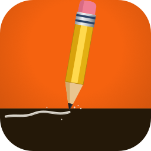
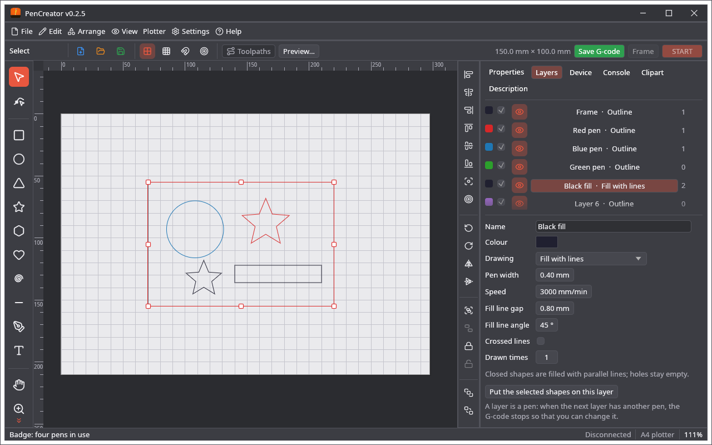

<p align="center"></p>

# PenCreator

Open-source pen plotter design and preparation software, written in Rust: devices, pens as layers, fill lines, a plot preview and G-code. **It writes G-code and can stream it to a GRBL plotter, but that has not been tried on a real machine.**

It shares its core and its interface code with [LightCreator](https://github.com/michalsarna/LightCreator) (laser) and
[MillCreator](https://github.com/michalsarna/MillCreator) (CNC mill) through [baseCreator](https://github.com/michalsarna/baseCreator),
pinned to a tag in `crates/pencreator/Cargo.toml`.

## Screenshots



More pictures (the start screen, the device, the plot and more) are on the [screenshots page](docs/SCREENSHOTS.md).

## What it does today

It looks like its siblings, because the window and its parts come from baseCreator:

* **Devices.** The start screen lists your plotters (add, edit, duplicate, export, import, delete); the choice is kept between runs. A device has the size of the sheet it reaches, the machine zero, the speed of the moves with the pen up, how the pen is lifted (the Z axis, or a servo with `M3 S…`, with the heights or values for up and down and a wait) and up to 8 cameras with a live Camera tab. **I have no device** makes a plain device called Dummy, and **New** or **Open…** without a device take the Dummy.
* **Pens as layers.** 64 layers, each one a pen: a colour, a pen width, a speed, outline, fill with lines (any angle and gap, crossed lines) or both, and how many times every line is drawn. When the next layer has another pen, the G-code stops with `M0` so that you can change it.
* **The plotter.** The device has a Connection page (serial port or network socket, baud rate, GRBL version from 0.7 to 1.1 and newer, streaming); the Device tab connects, homes, pauses and shows a console, the Control tab has **Raise the pen** / **Lower the pen**, **Start** / **Stop** and **Frame** (the pen goes round the box of the drawing, lifted) with **From line…**, and the control bar has **Save G-code**, **Toolpaths** (the paths over the work area), **Preview…** and **Camera view**.
* **Plot.** The Plotter menu opens a plot of the job (paper, the lines in the colours of the pens, the moves with the pen up dashed, an animation (play, pause, speed, repeat) with a progress slider, zoom and pan, the length, the number of pen lifts and the time) and exports **G-code** for GRBL. The strokes are ordered to shorten the moves with the pen up; fill lines zigzag and leave holes empty.
* The window has its own flat frame and title bar, a start screen (device, new design, open a file, recent files, language and colour scheme), a menu bar (the native menu bar on macOS), a control bar, a tool palette, an arrange bar and the Properties, Layers, Device, Clipart, Description and Camera tabs, and a status bar.
* The clipart gallery of baseCreator: 310 included pictures in 9 categories, search, your own pictures, and online search of open icon collections; a picture is placed as ordinary shapes.
* 30 languages for all texts (the shared ones from baseCreator, PenCreator's own ones in the program) and the colour schemes of LightCreator (Settings menu); the choice is kept.
* Opens an SVG, PDF or Illustrator (PDF-compatible) file, or a `.cre` project (File menu, drag and drop, or the path on the command line), imports a LightBurn project (File → Import: `.lbrn2` shapes, text outlines and bitmaps) or a UGS Designer design (File → Import: `.ugsd`), and saves projects as `.cre`. The project file is shared with LightCreator, MillCreator and other programs on baseCreator: it holds the drawing, the description and one section per program; PenCreator's is `pen` (layers and a note of the plotter). PenCreator keeps the sections of other programs untouched when it saves.
* Draws and edits shapes with the editor of baseCreator: select, node edit, rectangle, ellipse, triangle, star, polygon, heart, spiral, line, pen, pan and zoom; selection handles to move, resize, turn and slant; the usual commands (undo and redo, select all, copy, paste, duplicate, delete, group, ungroup); grid and snapping (View menu and View options…). Keyboard: tool letters as in LightCreator (V, N, R, E, ...), Ctrl+Z / Y, Ctrl+A / C / V / D / G, Delete, Ctrl+Shift+P (plot), Ctrl+Shift+G (G-code).

The **Control** tab jogs the plotter (steps, hold to move, keyboard), shows the work and machine position, zeroes X, Y and Z (G54 … G59) and has macros; a job stops at a change of the pen. The **Machine** menu has the settings of the controller (`$$`, with a backup before the first change), calibration, diagnostics with statistics and maintenance reminders, a check of the program, and **Start from line…**; alarms and errors are explained in your language, a device can be filled in from the controller, and copies of the controller settings are kept with it (a change is noticed at connecting). There is no HPGL and there are no single-line fonts yet, and neither the G-code nor the connection has been tried on a real plotter; see [FEATURES.md](FEATURES.md) and the safety notes in the wiki.

## Install

Ready-made packages for Windows, macOS and Linux are on the [Releases page](https://github.com/michalsarna/PenCreator/releases); see [INSTALL.md](INSTALL.md). Documentation (English and Polish) is in the [wiki](https://github.com/michalsarna/PenCreator/wiki).

## Examples

[`examples/`](examples) has a small badge (`badge.svg`) to import, a drawing for four pens as a project (`badge-pens.cre`: a frame, a circle, a star and a hatched fill, a pen for each layer; open it with *File → Open*) and the G-code the program makes from it (`badge-pens.nc`, with a servo pen lift). `cargo test -p pencreator write_examples -- --ignored` writes the last two again.

## Building

```sh
cargo run -p pencreator                       # start empty
cargo run -p pencreator -- drawing.svg        # open a file
cargo test --workspace
```

Add `--features camera` for live camera capture. On Linux the GUI needs the usual X11/Wayland and OpenGL libraries
(`libxkbcommon-x11`, `libgl1`).

To work on baseCreator and PenCreator together, point Cargo at your checkout of baseCreator (do not commit this file):

```toml
# .cargo/config.toml
[patch."https://github.com/michalsarna/baseCreator"]
base-core = { path = "../baseCreator/crates/base-core" }
base-ui   = { path = "../baseCreator/crates/base-ui" }
```

## Icon

`assets/icons/pencreator.svg` is the icon: the orange background and the brown base of the baseCreator icon, with a pencil
drawing a line on the base. `tools/make-icons.sh assets/icons/pencreator.svg pencreator` renders the PNGs, the `.ico` and
the `.icns` (needs inkscape; the `.icns` needs macOS). The screenshots are made by
`cargo test -p pencreator render_screenshots -- --ignored`.

<p align="center">
  <a href="SUPPORT.md">
    
  </a>
</p>

## Credits and licence

PenCreator is licensed under either of [Apache License 2.0](LICENSE-APACHE) or the [MIT license](LICENSE), at your option. Copyright (c) 2026 PenCreator contributors.

Unless you explicitly state otherwise, any contribution intentionally submitted for inclusion in PenCreator by you, as defined in the Apache-2.0 license, shall be dual licensed as above, without any additional terms or conditions.

It is built on many open-source projects, fonts and icon sets: see [CREDITS.md](CREDITS.md) and [`assets/LICENSES.md`](assets/LICENSES.md).
