# Screenshots

All pictures are rendered headlessly from the real UI (`cargo test -p pencreator render_screenshots -- --ignored`). Back to the [README](../README.md).

| | |
|---|---|
| 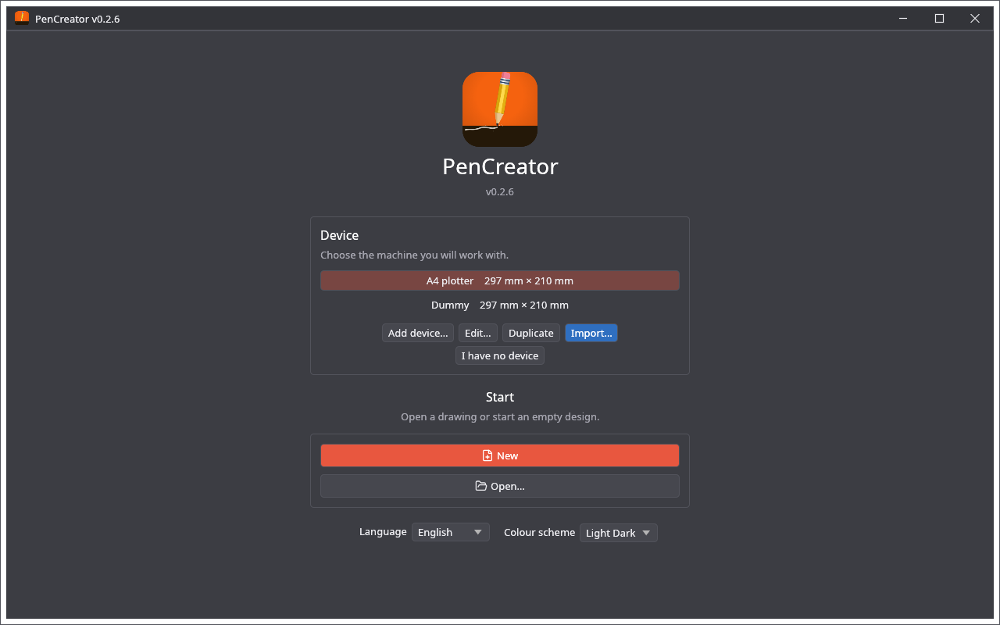 | 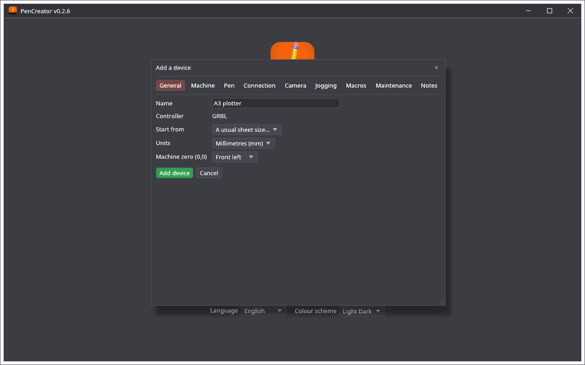 |
| Start screen | Adding a device |
| 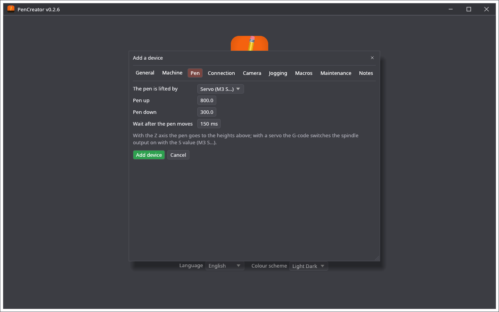 | 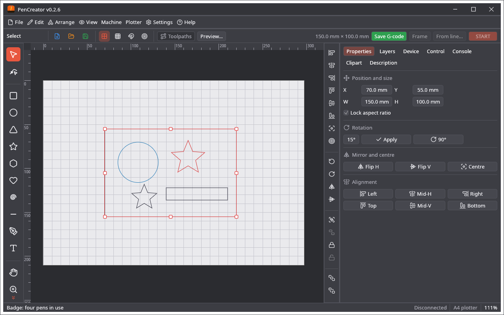 |
| The pen page of the device | A badge in the editor, Properties tab |
|  | 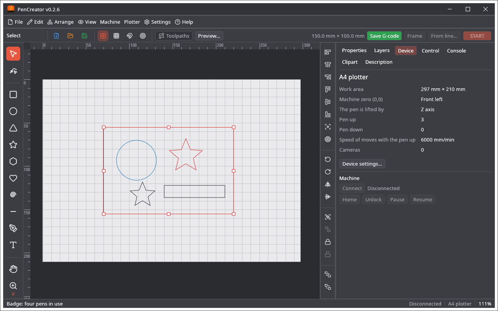 |
| The Layers tab: a pen is a layer | The Device tab |
| 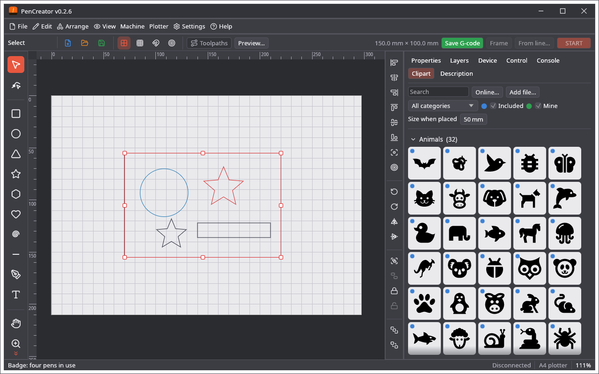 | 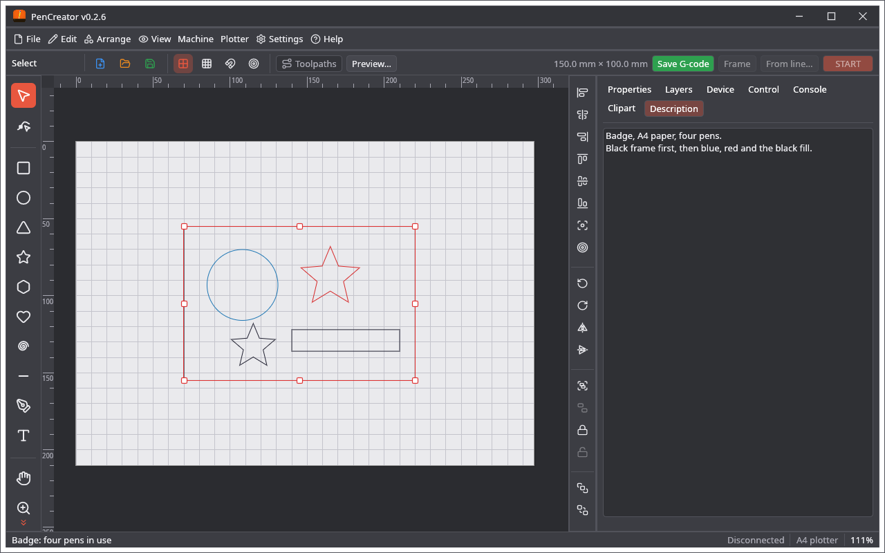 |
| Clipart gallery | The Description tab |
| 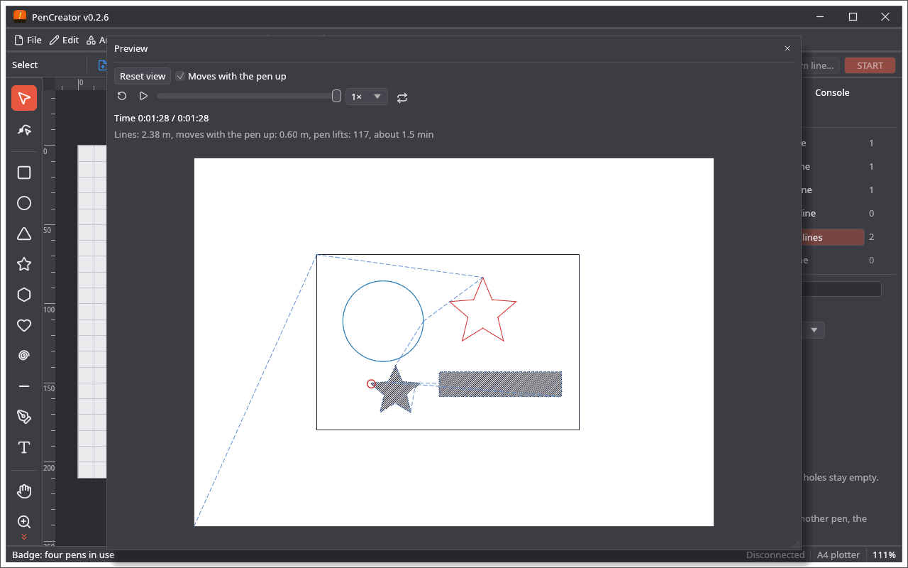 | 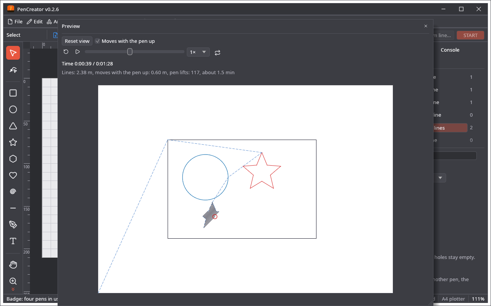 |
| The plot of the job | The plot, part way through |
| 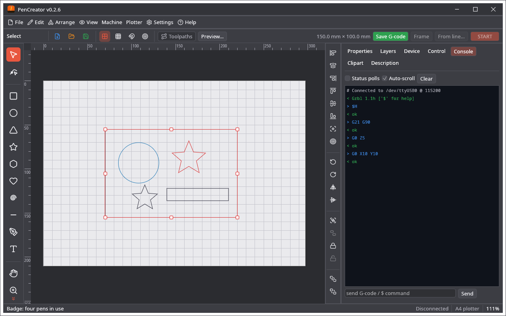 | 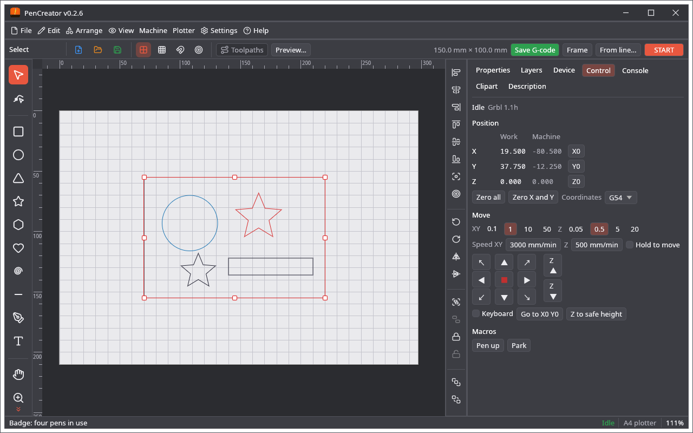 |
| Console tab: the traffic with the controller and a line to send a command | Control tab: position, zero, jogging, macros |
| 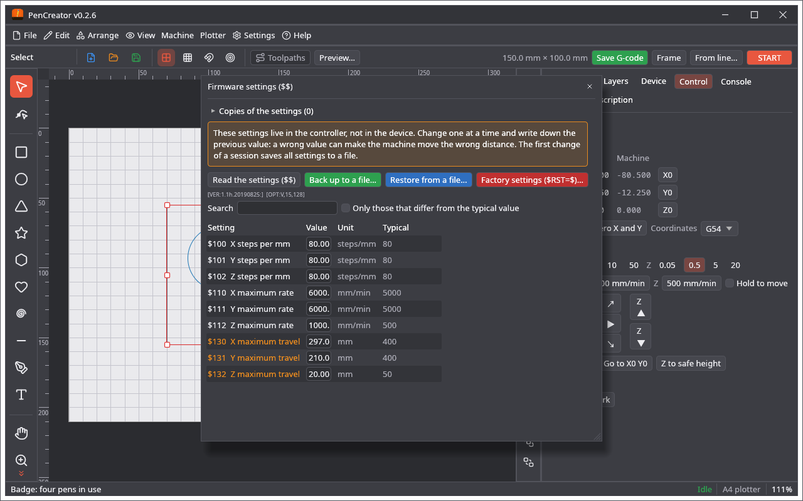 | 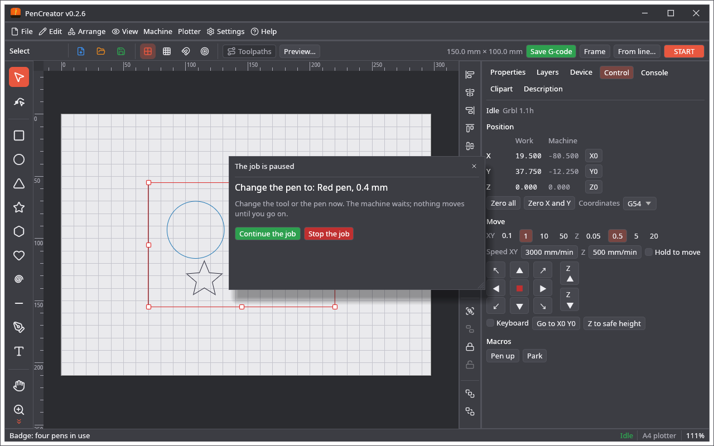 |
| Settings of the controller ($$) | The job waits for the pen to be changed |
