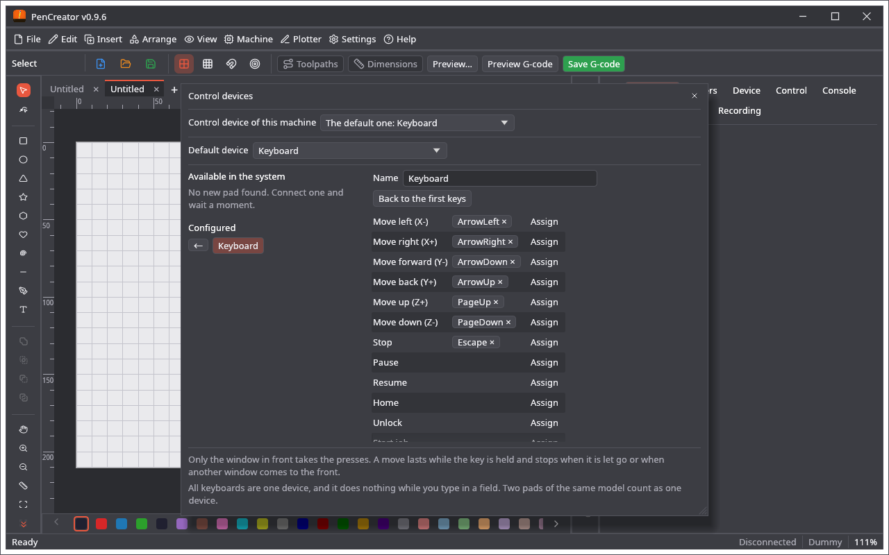

🌐 [English](Control-Devices) · [Polski](Urzadzenia-sterujace) · [简体中文](Control-Devices-ZH) · **한국어**

> ⚠️ 이 페이지는 영어판을 기계 번역한 것으로, 부정확한 부분이 있을 수 있습니다. 의심스러우면 [영어판](Control-Devices)을 기준으로 하십시오. 수정 제안을 환영합니다.

# 제어 장치

USB 패드나 키보드로 기계를 조작할 수 있습니다. **기계 → 제어 장치 ▸**(Machine → Control devices ▸)에는 항목이 두 개 있습니다. **제어 장치 설정…**(Control device settings…)은 장치와 그 키의 창을 열고, **이 기계의 제어 장치…**(Control device of this machine…)는 열려 있는 기계의 장치를 고릅니다.

## 장치

창에는 목록이 두 개 있습니다. **시스템에서 사용 가능**(Available in the system)은 아직 설정하지 않은 키보드와 연결된 패드를, **설정됨**(Configured)은 설정한 장치를 보여 줍니다. 화살표는 장치를 한 목록에서 다른 목록으로 옮깁니다. 되돌려 옮긴 장치는 다시 돌아올 경우에 대비해 키를 유지합니다.

* 컴퓨터의 모든 키보드는 장치 하나입니다. 시스템이 어느 키보드를 눌렀는지 창에 알려 주지 않기 때문입니다.
* 패드 모델마다 자체 키가 있는 장치 하나입니다. 같은 모델의 패드 두 개는 하나로 셉니다.
* **기본 장치**(Default device)는 기계에 자체 장치가 없을 때 모든 기계와 프로그램이 쓰는 장치를 고르거나 **기본 장치 없음**(No default device)을 고릅니다. 처음 설정한 장치가 기본 장치가 됩니다.

장치와 기본 장치는 LightCreator, MillCreator, PenCreator가 공유합니다. 한 프로그램에서 바꾸면 1초 안에 다른 프로그램에도 반영됩니다.

## 키

동작 옆의 **지정**(Assign)은 선택한 장치에서 누르기를 기다립니다. 키나 버튼 하나는 한 가지 일만 합니다. 다른 동작에 주면 첫 번째 동작에서는 빠집니다. 스틱은 방향마다 하나씩 버튼 두 개처럼 동작합니다. 키의 **×**는 키를 지우고, **처음 키로 되돌리기**(Back to the first keys)는 처음부터 다시 시작합니다. **마지막으로 누른 것**(Last pressed)은 장치가 보내는 것을 보여 주며, 버튼에 이름이 없는 패드에서 도움이 됩니다.

새 장치에는 이동과 정지만 있습니다. 무언가를 켜는 동작은 직접 키를 줄 때까지 키가 없습니다. 각 장치는 세 프로그램의 키를 모두 보관합니다. 여기서는 PenCreator가 할 수 있는 것을 봅니다.

X, Y, Z 이동, 정지(Stop), 일시 정지(Pause), 재개(Resume), 홈(Home), 잠금 해제(Unlock), 작업 시작(Start job), 프레임(Frame), **펜 올림**(Pen up), **펜 내림**(Pen down).

## 기계의 장치

**이 기계의 제어 장치…**는 열려 있는 기계의 장치를 고릅니다. 장치 하나가 여러 기계에 쓰일 수 있습니다. 자체 장치가 없거나 그 장치가 제거된 기계는 기본 장치를 씁니다. 기본 장치가 없으면 아무 일도 일어나지 않습니다.

## 동작 방식

* 맨 앞의 창만 누르기를 받으며, 그 창에서 열려 있는 기계로 보냅니다.
* 이동은 키를 누르고 있는 동안 계속됩니다(GRBL 1.1). 오래된 컨트롤러에서는 한 번 누를 때마다 한 단계입니다. 키를 놓거나, 다른 창이 앞으로 오거나, 패드가 사라지거나, 기계를 바꾸면 멈춥니다.
* 작업 중에는 정지, 일시 정지, 재개만 작동합니다.
* 설정 창이 열려 있는 동안에는 기계가 반응하지 않습니다. 키를 고르는 중이기 때문입니다.
* 필드에 입력하거나 Ctrl, Cmd, Alt를 누르고 있는 동안 키보드는 아무것도 하지 않습니다. 기계가 연결되어 있으면 그 키는 편집기가 아니라 기계로 갑니다. 처음 키 설정에서는 연결을 끊을 때까지 화살표가 선택한 도형을 움직이지 않습니다.
* 장치는 비상 정지를 대신하지 않습니다. 실제 비상 정지 버튼 가까이에 손을 두십시오.

## 백업

장치, 그 키, 기본 장치는 세 프로그램 각각의 백업(`app.ron`의 `control_devices`)에 들어 있으며, 기계의 선택은 기계와 함께 보관됩니다. 복원하면 공유되는 정의이므로 세 프로그램 모두의 정의가 바뀝니다. 그것이 없는 오래된 백업은 정의를 그대로 둡니다. 디스크에서는 공유 데이터 폴더의 `control_devices.json`에 있습니다.
