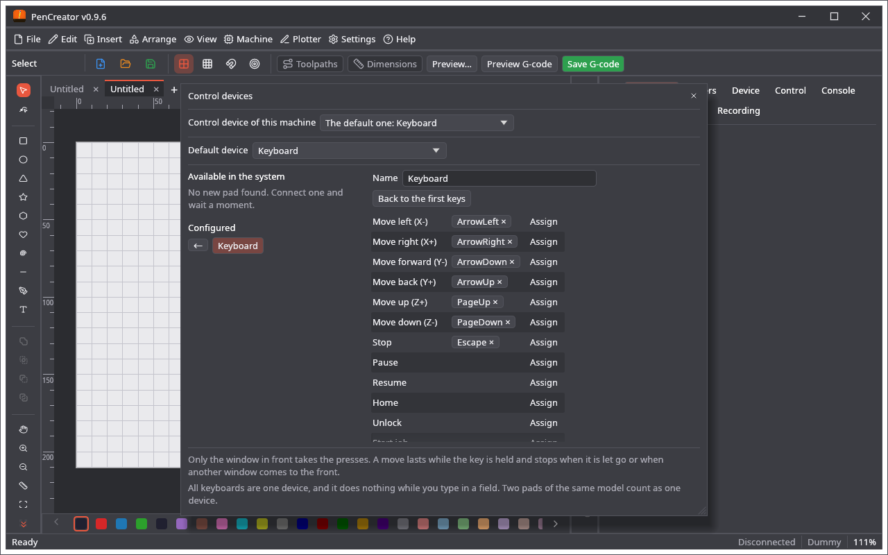

🌐 [English](Control-Devices) · [Polski](Urzadzenia-sterujace) · **简体中文** · [한국어](Control-Devices-KO)

> ⚠️ 本页由英文版机器翻译而成，可能有不准确之处。如有疑问，请以[英文版](Control-Devices)为准。欢迎提出修改建议。

# 控制设备

USB 手柄或键盘可以控制机器。**机器 → 控制设备 ▸**（Machine → Control devices ▸）有两个菜单项：**控制设备设置…**（Control device settings…）打开设备及其按键的窗口，**本机控制设备…**（Control device of this machine…）为当前打开的机器选择控制设备。

## 设备

窗口中有两个列表。**系统中可用**（Available in the system）显示尚未设置的键盘和已连接的手柄，**已配置**（Configured）显示已设置的设备。箭头可把设备从一个列表移到另一个列表。移回去的设备会保留其按键设置，以备它再次使用。

* 计算机的所有键盘算作一个设备：系统不会告诉窗口按下的是哪一个键盘。
* 每种型号的手柄是一个设备，有自己的按键设置；同一型号的两个手柄算作一个。
* **默认设备**（Default device）选择所有机器和程序使用的设备（除非某台机器有自己的设备），或选择 **无默认设备**（No default device）。你配置的第一个设备会成为默认设备。

设备和默认设备在 LightCreator、MillCreator 和 PenCreator 之间共用。在一个程序中的更改会在一秒内传到其他程序。

## 按键

动作旁的 **分配**（Assign）会等待所选设备上的一次按键。一个按键或按钮只做一件事：把它分配给另一个动作，就会从第一个动作上移除。摇杆相当于两个按钮，每个方向一个。按键上的 **×** 会将其移除，**恢复初始按键**（Back to the first keys）会重新开始。**最后按下**（Last pressed）显示设备发送的内容，这对按钮没有名称的手柄很有帮助。

新设备只有移动和停止。任何会开启某种功能的动作，在你为其分配按键之前都没有按键。每个设备保存全部三个程序的按键；这里列出 PenCreator 能执行的动作：

移动 X、Y 和 Z，停止（Stop），暂停（Pause），继续（Resume），回原点（Home），解锁（Unlock），开始作业（Start job），边框（Frame），**抬笔**（Pen up）和 **落笔**（Pen down）。

## 机器的设备

**本机控制设备…** 为当前打开的机器选择设备。一个设备可以服务多台机器。没有自己设备的机器，或其设备已被移除的机器，使用默认设备。没有默认设备时什么也不会发生。

## 行为方式

* 只有最前面的窗口接收按键，按键会发送到该窗口中打开的机器。
* 按住按键时持续移动（GRBL 1.1）；在较旧的控制器上，每按一次移动一步。松开按键、另一个窗口切到前台、手柄断开或切换机器时，移动停止。
* 作业期间只有停止、暂停和继续有效。
* 设置窗口打开时，机器不做反应：你正在选择按键。
* 在字段中输入或按住 Ctrl、Cmd 或 Alt 时，键盘不起作用。连接机器后，其按键发送到机器而不是编辑器：使用初始按键时，在断开连接之前，方向键不再移动选中的形状。
* 控制设备不能代替急停开关。请把手放在真正的急停开关附近。

## 备份

设备、其按键和默认设备包含在三个程序各自的备份中（`app.ron` 中的 `control_devices`），机器的选择随机器一起保存。恢复会替换全部三个程序中的定义，因为它们是共用的；不含这些内容的旧备份不会改动它们。在磁盘上，它们保存在共享数据文件夹中的 `control_devices.json`。
