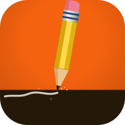
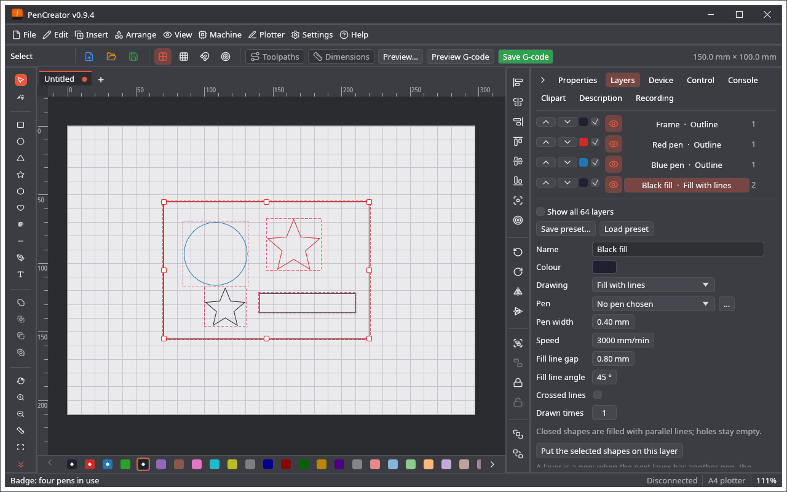

🌐 [English](Home) · [Polski](Home-PL) · [简体中文](Home-ZH) · **한국어**

> ⚠️ 이 페이지는 영어판을 기계 번역한 것으로, 부정확한 부분이 있을 수 있습니다. 의심스러우면 [영어판](Home)을 기준으로 하십시오. 수정 제안을 환영합니다.

# PenCreator

Rust로 작성된 펜 플로터용 오픈 소스 소프트웨어입니다. [Drawing Robot](https://www.printables.com/model/137296-drawing-robot-arduino-uno-cnc-shield-grbl)(Arduino UNO, CNC Shield, GRBL)을 바탕으로 만든 펜 플로터에서 테스트되었습니다. 장치, 레이어로서의 펜, 채우기 선, 플롯 미리 보기, GRBL용 G-code를 제공하며, G-code를 작성하고 GRBL 플로터로 스트리밍할 수 있습니다. [LightCreator](https://github.com/michalsarna/LightCreator)(레이저)와 [MillCreator](https://github.com/michalsarna/MillCreator)(CNC 밀링)의 자매 프로그램이며, [baseCreator](https://github.com/michalsarna/baseCreator)를 통해 같은 창, 편집기, 파일을 사용합니다.

## 시작하기

| 하고 싶은 일 | 페이지 |
|---|---|
| 프로그램 설치 | [설치](Installation-KO) |
| 첫 작업을 단계별로 만들기 | [빠른 시작](Quick-Start-KO) |
| 레이어 설정, 펜 선택, 펜 교체 이해 | [레이어와 펜](Layers-and-Pens-KO) |
| 메뉴에서 명령 찾기 | [메뉴](Menus-KO) |
| 단축키 익히기 | [키보드 단축키](Keyboard-Shortcuts-KO) |
| LightCreator, MillCreator와 프로젝트 공유 | [프로젝트 파일](Project-File-KO) |
| 도형 편집, 그림 가져오기, 탭과 창 | [디자인 도구](Design-Tools-KO) |
| 그림을 스타일 있는 선으로 그리기(점묘, 구불구불한 선, 해칭…) | [스타일 트레이스](Style-Trace-KO) |
| 드래그 나이프로 자르기, 나이프 라이브러리, HPGL 커터 | [드래그 나이프](Drag-Knife-KO) |
| 작업 영역 배치: 창, 탭, 윈도우 | [창과 탭](Panes-and-Tabs-KO) |
| 기계 조작: 조그, 원점, 펌웨어, 보정 | [기계 제어](Machine-Control-KO) |
| 화면 모습 보기 | [스크린샷](Screenshots-KO) |
| 설정 파일 찾기 | [설정과 파일](Settings-and-Files-KO) |
| 코드에 대해 읽기 | [아키텍처](Architecture-KO) |
| 있는 기능과 없는 기능 알기 | [안전과 제한 사항](Safety-and-Limitations-KO) |

## 테스트된 장치

이 프로그램은 다음 기계에서 시험했으며 정상적으로 작동합니다.

| 장치 | 종류 | 컨트롤러 |
|---|---|---|
| [Drawing Robot](https://www.printables.com/model/137296-drawing-robot-arduino-uno-cnc-shield-grbl)을 바탕으로 만든 펜 플로터 | 펜 플로터 | Arduino UNO, CNC Shield, GRBL |

다른 기계에서도 작동하나요? [이슈](https://github.com/michalsarna/PenCreator/issues)로 알려 주시면 목록에 추가합니다.
기계를 추가하는 방법이 담긴 목록: [TESTS_ON_DEVICES.md](https://github.com/michalsarna/PenCreator/blob/main/TESTS_ON_DEVICES.md).

## 한눈에 보기

* baseCreator의 **편집기**: 도형, 노드 편집, 텍스트, 그룹, 정렬, 실행 취소, 격자와 스냅을 장치의 작업 영역(Dummy는 A4)에서 사용합니다. 도면, 미리 보기, G-code 텍스트, 카메라는 탭이며 최대 세 개의 창에 배치할 수 있습니다.
* **가져오기와 내보내기:** SVG, PDF / Illustrator, DXF(R12 포함), LightBurn 프로젝트(`.lbrn2`, `.lbrn`), MillMage 프로젝트(`.mage`), UGS Designer 파일(`.ugsd`, 가져오기만), 온라인 검색이 가능한 클립아트 그림 310개.
* **프로젝트 파일:** `.cre`, LightCreator 및 MillCreator와 공유합니다. 저장할 때 다른 프로그램의 섹션은 그대로 유지됩니다.
* **인터페이스:** 38개 언어(PenCreator 고유 텍스트 포함)와 18가지 색 구성표.
* **장치와 펜:** 시작 화면의 플로터 목록(**장치가 없습니다**(I have no device)를 누르면 Dummy가 만들어집니다), 펜 역할을 하는 레이어 64개(색, 너비, 속도, 윤곽선, 선으로 채우기 또는 선으로 그리는 그림), 펜 라이브러리(**플로터 → 펜 라이브러리…**(Plotter → Pen library…)), 작업 플롯, 탭에 텍스트로 표시되는 G-code, GRBL용 G-code(Z축, 서보 또는 사용자 G-code로 펜을 들어 올림), AxiDraw / EggBot 및 HPGL 플로터, LinuxCNC용 G-code 파일.
* **기계 제어:** 조그, 원점, 매크로, 펌웨어 설정, 보정, 통계([기계 제어](Machine-Control-KO) 참조).
* **계획 중:** 단선 글꼴.

최신 릴리스: **v1.1.0** · [Releases](https://github.com/michalsarna/PenCreator/releases) · [Issues](https://github.com/michalsarna/PenCreator/issues) · 라이선스: [MIT](https://github.com/michalsarna/PenCreator/blob/main/LICENSE) 또는 [Apache-2.0](https://github.com/michalsarna/PenCreator/blob/main/LICENSE-APACHE) 중 선택
