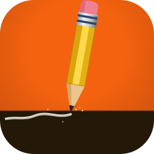

🌐 [English](Home) · [Polski](Home-PL) · **简体中文** · [한국어](Home-KO)

> ⚠️ 本页由英文版机器翻译而成，可能有不准确之处。如有疑问，请以[英文版](Home)为准。欢迎提出修改建议。

# PenCreator

用 Rust 编写的开源笔式绘图仪软件。它已在一台按照 [Drawing Robot](https://www.printables.com/model/137296-drawing-robot-arduino-uno-cnc-shield-grbl)（Arduino UNO、CNC Shield、GRBL）制作的笔式绘图仪上测试过。它提供设备、以图层表示的笔、填充线、绘图预览和面向 GRBL 的 G-code；它生成 G-code，并可将其流式发送到 GRBL 绘图仪。它是 [LightCreator](https://github.com/michalsarna/LightCreator)（激光）和 [MillCreator](https://github.com/michalsarna/MillCreator)（CNC 铣床）的姊妹程序，通过 [baseCreator](https://github.com/michalsarna/baseCreator) 共用同样的窗口、编辑器和文件。

## 从哪里开始

| 我想要… | 前往 |
|---|---|
| 安装程序 | [安装](Installation-ZH) |
| 一步步完成第一个作业 | [快速入门](Quick-Start-ZH) |
| 设置图层、选择笔、了解换笔 | [图层与笔](Layers-and-Pens-ZH) |
| 在菜单中查找命令 | [菜单](Menus-ZH) |
| 学习快捷键 | [键盘快捷键](Keyboard-Shortcuts-ZH) |
| 与 LightCreator 和 MillCreator 共享项目 | [项目文件](Project-File-ZH) |
| 编辑形状、导入图片、标签页和窗格 | [设计工具](Design-Tools-ZH) |
| 将图片以某种风格绘制为线条（点画、波浪线、排线…） | [风格描摹](Style-Trace-ZH) |
| 用拖刀切割、刀具库、HPGL 切割机 | [拖刀](Drag-Knife-ZH) |
| 安排工作区：窗格、标签页、窗口 | [窗格与标签页](Panes-and-Tabs-ZH) |
| 控制机器：点动、归零、固件、校准 | [机器控制](Machine-Control-ZH) |
| 看看它的样子 | [截图](Screenshots-ZH) |
| 查找设置文件 | [设置与文件](Settings-and-Files-ZH) |
| 了解代码 | [架构](Architecture-ZH) |
| 了解有哪些功能、缺少哪些功能 | [安全与限制](Safety-and-Limitations-ZH) |

## 已测试的设备

本程序已在以下机器上试用并可正常工作：

| 设备 | 类型 | 控制器 |
|---|---|---|
| 按照 [Drawing Robot](https://www.printables.com/model/137296-drawing-robot-arduino-uno-cnc-shield-grbl) 制作的笔式绘图仪 | 笔式绘图仪 | Arduino UNO、CNC Shield、GRBL |

它能在其他机器上运行？请在 [issue](https://github.com/michalsarna/PenCreator/issues) 中告诉我，它就会加入列表。
列表及添加机器的方法：[TESTS_ON_DEVICES.md](https://github.com/michalsarna/PenCreator/blob/main/TESTS_ON_DEVICES.md)。

## 概览

* **编辑器**来自 baseCreator：形状、节点编辑、文本、编组、对齐、撤销、网格和吸附，位于设备的工作区上（Dummy 为 A4）。绘图、预览、G-code 文本和摄像头都是标签页，最多可分布在三个窗格中。
* **导入和导出：** SVG、PDF / Illustrator、DXF（也包括 R12）、LightBurn 项目（`.lbrn2`、`.lbrn`）、MillMage 项目（`.mage`）、UGS Designer 文件（`.ugsd`，仅导入）；310 张剪贴画图片，并支持在线搜索。
* **项目文件：** `.cre`，与 LightCreator 和 MillCreator 共用；保存时会保留其他程序的部分。
* **界面：** 38 种语言（包括 PenCreator 自己的文本）和 18 种配色方案。
* **设备和笔：** 开始屏幕上的绘图仪列表（**我没有设备**（I have no device）会创建 Dummy）、64 个作为笔的图层（颜色、宽度、速度、轮廓、用线条填充或用线条绘制的图片）、笔库（**绘图仪 → 笔库…**（Plotter → Pen library…））、作业绘图、标签页中的 G-code 文本、面向 GRBL 的 G-code（由 Z 轴、舵机或自定义 G-code 抬笔）、AxiDraw / EggBot 和 HPGL 绘图仪，以及供 LinuxCNC 使用的 G-code 文件。
* **机器控制：** 点动、归零、宏、固件设置、校准、统计（参见[机器控制](Machine-Control-ZH)）。
* **计划中：** 单线字体。

最新版本：**v0.9.10** · [Releases](https://github.com/michalsarna/PenCreator/releases) · [Issues](https://github.com/michalsarna/PenCreator/issues) · 许可证：[MIT](https://github.com/michalsarna/PenCreator/blob/main/LICENSE) 或 [Apache-2.0](https://github.com/michalsarna/PenCreator/blob/main/LICENSE-APACHE)，任选其一
