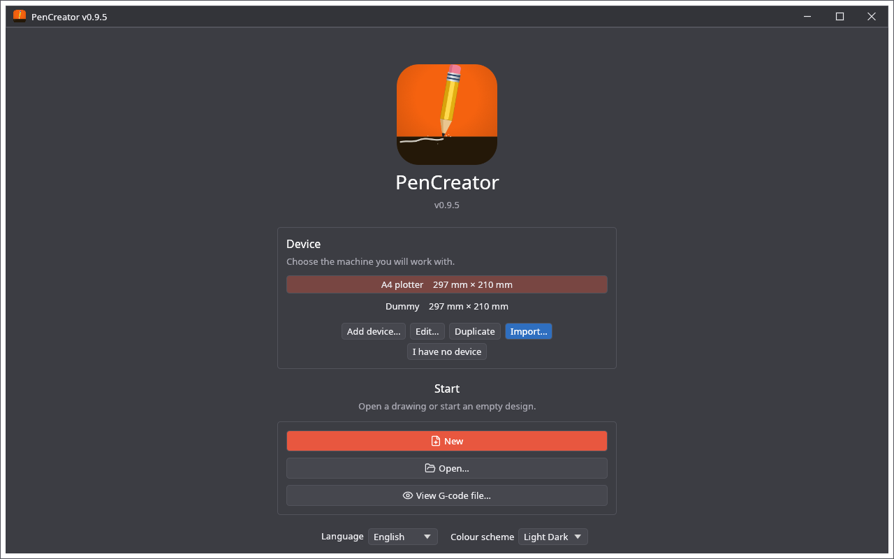
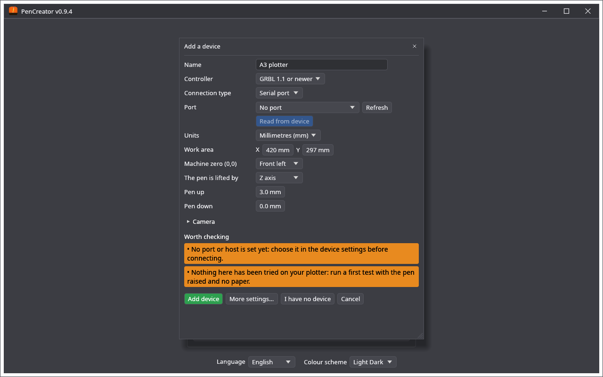
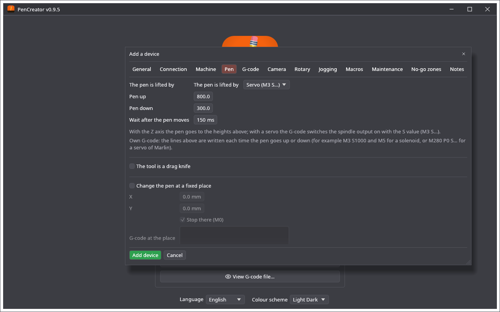
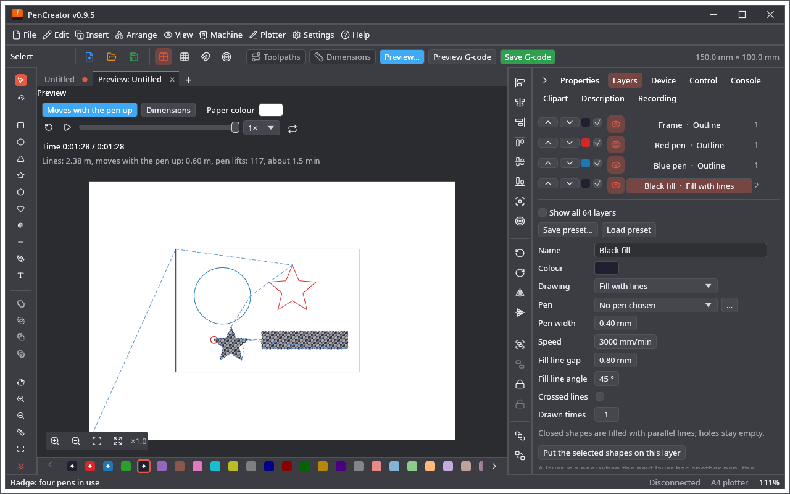

🌐 [English](Quick-Start) · [Polski](Szybki-start) · [简体中文](Quick-Start-ZH) · **한국어**

> ⚠️ 이 페이지는 영어판을 기계 번역한 것으로, 부정확한 부분이 있을 수 있습니다. 의심스러우면 [영어판](Quick-Start)을 기준으로 하십시오. 수정 제안을 환영합니다.

# 빠른 시작

처음부터 끝까지 진행하는 첫 작업입니다. 플로터를 고르고, 무언가를 그리거나 가져오고, 도형에 펜을 지정하고, 플롯과 G-code를 확인한 뒤 G-code를 저장하거나 기계로 보냅니다.

> PenCreator는 [Drawing Robot](https://www.printables.com/model/137296-drawing-robot-arduino-uno-cnc-shield-grbl)(Arduino UNO, CNC Shield, GRBL)을 바탕으로 만든 펜 플로터에서 테스트되었습니다. 사용하는 기계는 다를 수 있습니다. G-code는 자동 테스트와 GRBL 시뮬레이터에서도 검사됩니다. 작업을 실행하기 전에 [안전과 제한 사항](Safety-and-Limitations-KO)을 읽으십시오.

## 1. 장치 선택

시작 화면의 **장치**(Device) 아래에 플로터 목록이 표시됩니다(각각 작업 영역 크기와 함께). 하나를 클릭하면 선택됩니다.

* **장치가 없습니다**(I have no device)는 **Dummy**라는 간단한 장치를 추가하고 선택합니다. A4 용지이며 펜은 Z축으로 들어 올립니다. 목록 아래의 **용지**(Paper) A4 **가로**(Landscape) / **세로**(Portrait)로 용지 방향을 바꿉니다(나중에는 편집기의 **장치** 탭에서 같은 설정을 할 수 있습니다). 장치가 하나도 없으면 **새로 만들기**(New)와 **열기…**(Open…)는 Dummy를 사용합니다.
* **장치 추가…**(Add device…)는 LightCreator, MillCreator와 같은 기본 설정 창 하나를 엽니다. **이름**(Name), **컨트롤러**(Controller)(GRBL 버전, AxiDraw / EggBot, HPGL 플로터 또는 LinuxCNC), **장치에서 읽기**(Read from device)가 있는 연결(GRBL은 작업 영역과 속도를 알려 줍니다), **단위**(Units), **작업 영역**(Work area)(X와 Y, 펜이 닿을 수 있는 용지), **기계 원점 (0,0)**(Machine zero (0,0))(펜이 시작하는 모서리), **펜을 들어 올리는 방식**(The pen is lifted by): **Z축**(Z axis)(이때 **펜 올림**(Pen up)과 **펜 내림**(Pen down)은 mm 단위 높이이며, 내림 0이 용지 면입니다) 또는 **서보 (M3 S…)**(Servo (M3 S…))(이때는 `S` 값, 0 … 1000), 선택 사항인 카메라, 그리고 **확인할 만한 사항**(Worth checking)이 있습니다. 새 장치는 올림 3 mm, 내림 0으로 시작합니다.

  **장치 추가**(Add device)는 장치를 저장합니다. **추가 설정…**(More settings…)은 입력한 내용을 가지고 전체 장치 창을 엽니다(펜이 움직인 뒤의 대기 시간, 펜을 든 상태의 이동 속도, 그리기 시간 계산용 **X, Y, Z 가속도**(Acceleration of X, Y, Z)와 **접합 편차**(Junction deviation), **시작 기준 → 일반적인 용지 크기…**(Start from → A usual sheet size…)). **장치 추가…** 옆에는 **편집…**(Edit…), **복제**(Duplicate), **가져오기…**(Import…)(장치 파일)가 있습니다.

저장하지 않은 작업이 있는 상태로 프로그램이 닫혔다면 시작 화면에 먼저 *저장되지 않은 프로젝트를 찾았습니다*(A project that was not saved was found)가 표시됩니다. **복구**(Recover)는 그 프로젝트를 열고, **버리기**(Discard it)는 잊어버립니다.

## 2. 도면 시작

**시작**(Start) 아래에서:

* **새로 만들기**(New)는 장치의 용지 위에 빈 도면을 시작합니다.
* **열기…**(Open…)는 프로젝트(`.cre`), SVG, PDF 또는 Illustrator(`.ai`) 파일을 엽니다. DXF나 UGS 디자인(`.ugsd`)은 새 도면으로 가져옵니다.
* **G-code 파일 보기…**(View G-code file…)는 도면 없이 G-code 파일의 공구 경로를 보여 줍니다.
* **최근 파일 열기**(Open recent) 아래에 마지막 파일 다섯 개가 있습니다.

편집기에는 메뉴 바([메뉴](Menus-KO) 참조), 그 아래의 버튼 바, 왼쪽의 도구, 배치 바와 오른쪽의 사이드 패널(탭: **속성**(Properties), **레이어**(Layers), **장치**(Device), **제어**(Control), **콘솔**(Console), **클립아트**(Clipart), **설명**(Description), 그리고 장치에 카메라가 있으면 **카메라**(Camera)), 작업 영역 아래의 레이어 줄, 맨 아래의 상태 줄(메시지, 확대 비율과 포인터 위치, 프로젝트의 장치, 연결)이 있습니다.

각 도면은 작업 영역 위의 탭입니다. **새로 만들기**(Ctrl+N) 또는 탭 끝의 **+**로 다른 도면을 엽니다(최대 10개). 창에 파일을 끌어 놓으면 열립니다. 그림은 가져오기 대화 상자를 거치고, LightBurn, UGS 또는 DXF 파일은 도면으로 가져오며, G-code 파일은 분석 화면에 표시됩니다.

### 프로젝트 설정

**새로 만들기** 뒤에는 **프로젝트 설정**(Project setup) 창(**파일 → 프로젝트 설정…**(File → Project setup…)에서도 열 수 있음)이 **용지**(Sheet)에 대해 묻습니다. 너비와 높이를 입력하거나, 일반적인 크기 목록(A6 … A1, B5, B4, Letter, Legal, Tabloid) 중 플로터에 맞는 것만 표시되는 **용지 크기**(Paper size)를 세로(↕) 또는 가로(↔)로 고르거나, **원통 (로터리)**(Cylinder (rotary))(지름과 길이. 적용하면 로터리 부착 장치가 켜집니다)를 고릅니다. 녹색 **적용**(Apply)과 파란색 **건너뛰기**(Skip)는 창 아래쪽에 있습니다. 새 프로젝트에서 **건너뛰기**를 누르거나 창을 닫으면 플로터의 전체 작업 영역을 덮는 단면 상태로 남습니다. 용지는 플로터 원점이 있는 모서리에 가장자리에서 3 mm 안쪽으로 놓입니다(점선 윤곽). **양면 작업**(Two-sided job)은 A면과 B면을 만들고 작업 영역 위에 **A면 / B면**(Side A / Side B) 전환 스위치를 둡니다. 용지를 **뒤집는 기준선**(Turned over round)을 **H**(앞뒤가 바뀜) 또는 **V**(좌우가 바뀜)로 고르고, **정렬 표시**(Alignment marks)를 추가할지 정합니다(용지 바로 바깥의 모서리 표시 네 개로, 레이어 64에 있으며 A면 전에 아래쪽 종이에 그립니다). B면은 뒤집은 뒤 용지가 놓인 모습 그대로 그리고, 그린 그대로 플롯합니다(작업은 현재 표시된 면입니다). 각 면에는 반대쪽 면이 뒤집힌 모습으로 흐린 점선 **고스트**(ghosts)로 표시됩니다.

## 3. 그리기 또는 가져오기

* 왼쪽 도구로 **그립니다**: **선택 (V)**(Select (V)), **노드 편집 (N)**(Node edit (N)), **사각형 (R)**(Rectangle (R)), **타원 (E)**(Ellipse (E)), **삼각형 (Y)**(Triangle (Y)), **별 (S)**(Star (S)), **다각형 (G)**(Polygon (G)), **하트 (K)**(Heart (K)), **나선 (I)**(Spiral (I)), **선 (L)**(Line (L)), **폴리라인 / 펜 (P)**(Polyline / pen (P)), **텍스트 (T)**(Text (T)), **이동 (H)**(Pan (H)), **확대 (Z)**(Zoom in (Z)), **축소 (X)**(Zoom out (X)). **삽입**(Insert) 메뉴에도 같은 그리기 도구가 있습니다. **속성**(Properties) 탭에서 선택한 도형의 크기, 위치, 세부 사항을 바꿉니다.
* **파일 → 가져오기**(File → Import)로 **가져옵니다**: **이미지 가져오기…**(Import image…), **SVG 가져오기…**(Import SVG…), **Adobe Illustrator / PDF / EPS / VectorCraft 가져오기…**(Import Adobe Illustrator / PDF / EPS / VectorCraft…), **DXF 가져오기…**(Import DXF…), **LightBurn / MillMage 프로젝트 가져오기…**(Import LightBurn / MillMage project…), **UGS 디자인 가져오기…**(Import UGS design…), 또는 플러그인의 가져오기 도구와 생성기. 도형은 선택된 상태로 도면에 추가됩니다. UGS 디자인은 절삭 방식에 맞는 빈 레이어도 준비합니다(포켓이나 채우기는 **선으로 채우기**(Fill with lines), 나머지는 **윤곽선**(Outline)이 됩니다).
* **클립아트**: **클립아트**(Clipart) 탭에는 배치할 그림 갤러리가 있고, **삽입 → 온라인 클립아트…**(Insert → Online clipart…)는 인터넷에서 검색합니다.

텍스트는 단선이 아니라 글꼴의 윤곽선(각 글자의 가장자리를 따라)으로 그려집니다. 편집, 배치, 그림에 대해서는 [디자인 도구](Design-Tools-KO)를 참조하십시오.

## 4. 도형에 펜 지정

새 도형은 **활성 레이어**(active layer)에 놓입니다. 레이어는 곧 펜입니다.

1. 도형을 선택하고 작업 영역 아래 레이어 줄의 색을 클릭합니다. 도형이 그 레이어로 옮겨지고 그 레이어가 활성 레이어가 됩니다. (또는 **레이어**(Layers) 탭에서 레이어를 고르고 **선택한 도형을 이 레이어에 놓기**(Put the selected shapes on this layer)를 누릅니다.)
2. **레이어** 탭에서 레이어를 설정합니다: **그리기**(Drawing)(**윤곽선**(Outline), **선으로 채우기**(Fill with lines), **채우기와 윤곽선**(Fill and outline) 또는 **그림**(Picture)), **펜**(Pen)(**플로터 → 펜 라이브러리…**(Plotter → Pen library…)의 펜), **펜 너비**(Pen width), **속도**(Speed), 채우기 선, **그리는 횟수**(Drawn times).
3. 레이어 목록은 작업 순서입니다(▲ / ▼로 레이어를 옮깁니다). 체크하지 않은 레이어는 그려지지 않습니다.

다음 레이어에 다른 펜이 필요하면 작업이 멈추고 펜을 교체합니다. 레이어, 펜, 펜 교체에 관한 모든 내용은 [레이어와 펜](Layers-and-Pens-KO)에 있습니다.

## 5. 플롯 확인

**플로터 → 작업 플롯…**(Plotter → Plot of the job…)(Ctrl+Shift+P) 또는 메뉴 아래 바의 **미리 보기…**(Preview…) 버튼을 누르면 도면 옆에 **미리 보기: 이름**(Preview: name) 탭이 열립니다.

* 펜이 그릴 선이 잉크 색과 굵기대로 표시된 용지, 그리고 펜을 든 상태의 이동이 파란 점선으로 표시됩니다(**펜을 든 이동**(Moves with the pen up)으로 끕니다). 그 옆의 **용지 색**(Paper colour)으로 용지를 실제 종이 색으로 바꿉니다(선택하기 전에는 흰색이며, **자동**(Automatic)은 흰색으로 돌아갑니다).
* 진행 슬라이더가 있는 애니메이션(**재생**(Play) / **일시 정지**(Pause), **처음으로**(Back to the start), **반복**(Repeat), **애니메이션 속도**(Animation speed)). 빨간 원이 펜입니다.
* 시간(**시간**(Time): 지금까지 / 전체. 장치의 가속도가 있으면 GRBL이 계획하는 방식대로 가속과 감속, 모서리에서 느려지는 것, 펜이 오르내리는 정지 시간을 계산합니다), 선의 길이와 펜을 든 이동의 길이, 펜을 든 횟수, 분.
* 주황색 경고: 그릴 수 없는 그림, 일부가 작업 영역 밖에 있는 도면, 선이 너무 많은 채우기.
* 그림 왼쪽 아래 구석의 확대/축소 바: 확대, 축소, **보기 재설정**(Reset view)(작업 영역), **모든 객체 맞추기**(Fit all objects)(모든 선). 휠로 확대/축소하고, 끌어서 이동하며, 더블 클릭하면 처음 보기로 돌아갑니다.

미리 보기는 도면을 바꾸면 따라서 바뀝니다. **공구 경로**(Toolpaths) 버튼(켜져 있으면 녹색)은 같은 경로를 작업 영역 위에 대신 그립니다. 선은 레이어 색으로, 펜을 든 이동은 연한 파란색으로 표시됩니다.

## 6. G-code 확인

**G-code 미리 보기**(Preview G-code)(바에서 **G-code 저장**(Save G-code) 옆)는 프로젝트의 G-code를 만들어 **G-code 미리 보기: 이름.nc**(Preview G-code: name.nc) 탭에 텍스트로 보여 줍니다. 디스크에는 아무것도 쓰지 않습니다. **G-code 저장**이 쓰는 것과 같은 G-code입니다(첫 줄은 `(PenCreator: name)`). 단어(G와 M 단어, 축, 속도, 주석)에 색이 입혀지며 텍스트를 편집할 수 있습니다.

* 탭의 **G-code 저장**(Save G-code)은 편집한 내용을 포함한 텍스트를 파일로 씁니다.
* **다시 만들기**(Make again)는 프로젝트에서 다시 만듭니다. 편집한 내용이 있으면 버튼이 먼저 **편집 내용을 버릴까요?**(Lose the edits?)라고 묻고, 한 번 더 클릭하면 만듭니다.
* **분석**(Analyse)은 텍스트의 공구 경로를 **G-code 분석**(G-code analysis) 탭에 보여 줍니다.
* *직접 변경됨*(Changed by hand)과 탭의 점이 편집 여부를 표시합니다. 그런 탭을 닫으면 저장할지 묻습니다.
* 편집 내용이 없는 동안에는 프로젝트를 저장하거나, 메모(**설명**(Description) 탭)가 바뀌거나, 장치 설정이 바뀌거나, 포스트프로세서를 켜거나 끄면 잠시 뒤 텍스트가 자동으로 다시 만들어집니다. 직접 편집한 내용은 이 과정에서 절대 버려지지 않습니다.

탭은 나란히 둘 수 있습니다. **보기 → 분할 보기: 나란히**(View → Split view: side by side)를 쓰거나 탭을 다른 창으로 끌어 놓습니다([창과 탭](Panes-and-Tabs-KO) 참조).

## 7. 프로젝트 저장

**파일 → 저장**(File → Save)(Ctrl+S)은 프로젝트를 `.cre`로 씁니다(처음에는 이름을 묻습니다). 그 뒤로는 변경 내용이 약 20초 뒤 자동으로 그 파일에 저장됩니다. 프로젝트에는 도면, 레이어, **설명** 탭의 메모, 장치에 관한 메모가 들어 있습니다. [프로젝트 파일](Project-File-KO)을 참조하십시오. 메모는 G-code 맨 위에도 `(Note: …)` 줄로 기록됩니다.

## 8. G-code 저장 또는 플롯

**G-code를 파일로 저장:** **G-code 저장**(Save G-code) 버튼 또는 **플로터 → G-code 내보내기…**(Plotter → Export G-code…)(Ctrl+E). 파일 이름은 프로젝트 이름을 따릅니다(`name.nc`. 프로젝트를 저장하기 전에는 `untitled.nc`). 상태 줄에 저장 위치가 표시되고 경고가 다시 표시됩니다. 켜져 있는 플러그인의 포스트프로세서가 파일을 바꿉니다([플러그인](Plugins-KO) 참조). 파일은 다른 프로그램으로 보내거나, 다음과 같이 합니다.

**PenCreator에서 GRBL 플로터로 보내기:**

1. **기계 → 장치 설정…**(Machine → Device settings…)의 **연결**(Connection) 페이지에서 **연결 방식**(Connection type)(**시리얼 포트**(Serial port) 또는 **네트워크 (TCP, 예: ser2net)**(Network (TCP, e.g. ser2net))), **포트**(Port) 또는 **호스트**(Host), 보드의 **GRBL 버전**(GRBL version)을 정합니다. **저장**(Save)합니다.
2. **장치**(Device) 탭에서 **연결**(Connect)합니다. 상태 줄에 기계 상태가 표시됩니다.
3. **제어**(Control) 탭에서: **펜 올리기**(Raise the pen)와 **펜 내리기**(Lower the pen)로 올림과 내림 위치를 시험합니다. 조그 버튼은 펜을 움직입니다. **프레임**(Frame)은 펜을 든 채로 도면의 경계 상자를 한 바퀴 돕니다.
4. **시작**(Start)으로 작업을 보냅니다. 펜을 교체할 때 작업이 멈추고 어떤 펜을 꽂을지 창에 표시됩니다. **작업 계속**(Continue the job)을 누르면 이어서 진행합니다. **STOP**은 작업을 멈춥니다.

기계 제어는 [기계 제어](Machine-Control-KO)에 설명되어 있습니다.
