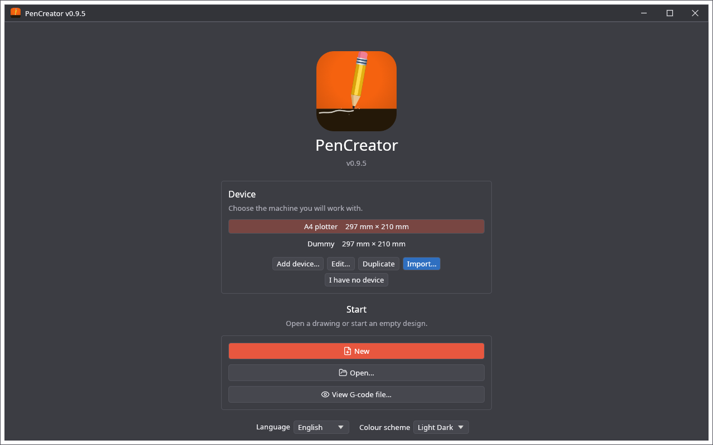
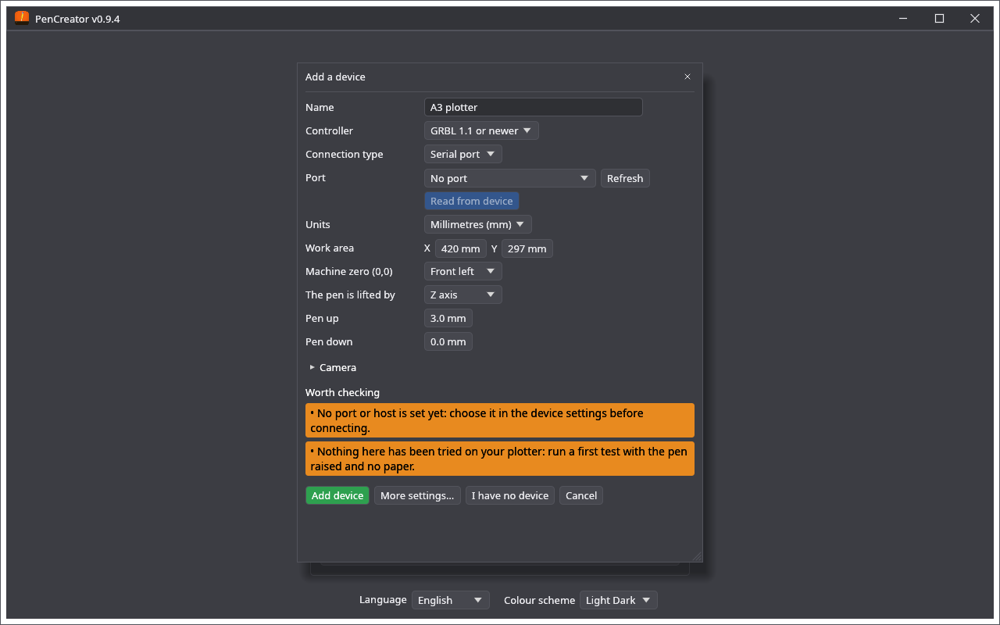
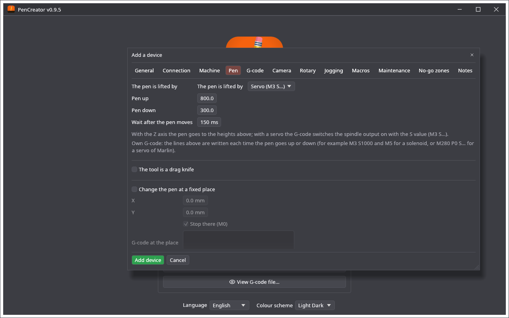
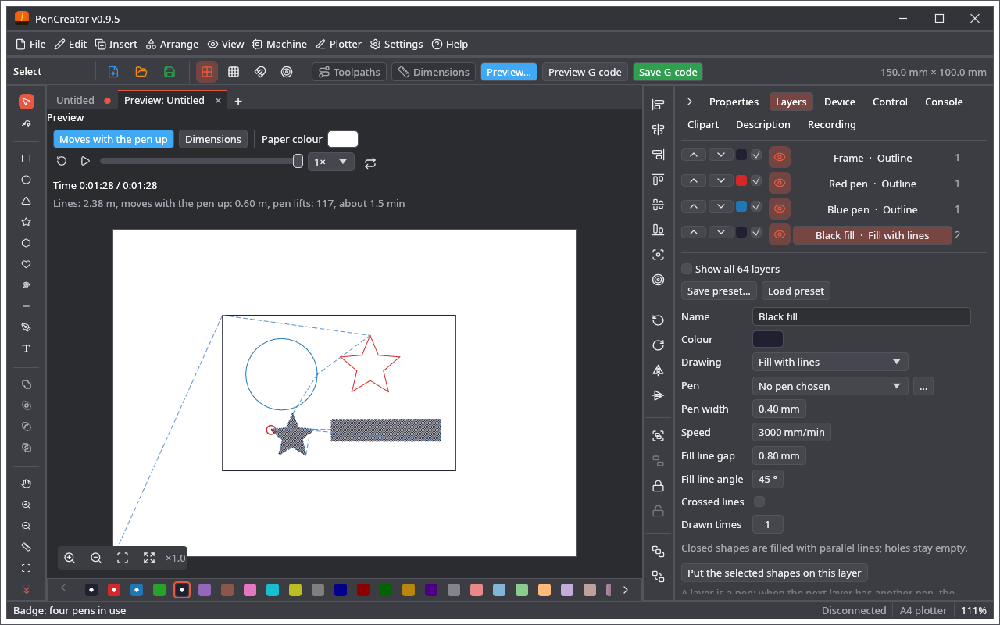

🌐 [English](Quick-Start) · [Polski](Szybki-start) · **简体中文** · [한국어](Quick-Start-KO)

> ⚠️ 本页由英文版机器翻译而成，可能有不准确之处。如有疑问，请以[英文版](Quick-Start)为准。欢迎提出修改建议。

# 快速入门

从头到尾完成第一个作业：选择绘图仪，绘制或导入内容，为形状指定笔，查看绘图和 G-code，然后保存 G-code（或将其发送到机器）。

> PenCreator 已在一台按照 [Drawing Robot](https://www.printables.com/model/137296-drawing-robot-arduino-uno-cnc-shield-grbl)（Arduino UNO、CNC Shield、GRBL）制作的笔式绘图仪上测试过；你的机器可能有所不同。G-code 还经过自动测试和 GRBL 模拟器的检查。运行作业前请先阅读[安全与限制](Safety-and-Limitations-ZH)。

## 1. 选择设备

开始屏幕在 **设备**（Device）下列出你的绘图仪（每台都标有其工作区尺寸）。单击其中一台即可选择。

* **我没有设备**（I have no device）会添加并选择一个名为 **Dummy** 的简单设备：一张 A4 纸，由 Z 轴抬笔。在列表下方，**纸张**（Paper）A4 **横向**（Landscape）/ **纵向**（Portrait）可以旋转其纸张（之后在编辑器的 **设备** 标签页中也有同样的选项）。没有任何设备时，**新建**（New）和 **打开…**（Open…）会使用 Dummy。
* **添加设备…**（Add device…）会打开一个包含基本设置的窗口，与 LightCreator 和 MillCreator 中的相同：**名称**（Name）、**控制器**（Controller）（某个 GRBL 版本、AxiDraw / EggBot、HPGL 绘图仪或 LinuxCNC）、连接及 **从设备读取**（Read from device）（GRBL 会给出其工作区和速度）、**单位**（Units）、**工作区**（Work area）（X 和 Y，即笔能到达的纸张范围）、**机器零点 (0,0)**（Machine zero (0,0)）（笔开始的角落）、**抬笔方式**（The pen is lifted by）：**Z 轴**（Z axis）（此时 **抬笔**（Pen up）和 **落笔**（Pen down）是以 mm 为单位的高度；落笔 0 即纸面）或 **舵机 (M3 S…)**（Servo (M3 S…)）（此时它们是 `S` 值，0 … 1000），可选的摄像头，以及 **值得检查**（Worth checking）。新设备默认抬笔 3 mm、落笔 0。

  **添加设备**（Add device）会保存设备；**更多设置…**（More settings…）会带着已输入的内容打开完整的设备窗口（笔移动后的等待时间、抬笔移动的速度、用于计算绘图时间的 **X、Y、Z 加速度**（Acceleration of X, Y, Z）和 **转角偏差**（Junction deviation）、**起始于 → 常用纸张尺寸…**（Start from → A usual sheet size…））。**编辑…**（Edit…）、**复制**（Duplicate）和 **导入…**（Import…）（设备文件）位于 **添加设备…** 旁边。

如果程序关闭时有未保存的工作，开始屏幕会先显示 *发现一个未保存的项目*（A project that was not saved was found）：**恢复**（Recover）会打开它，**丢弃**（Discard it）会将其舍弃。

## 2. 开始绘图

在 **开始**（Start）下：

* **新建**（New）在设备的纸张上开始一个空白绘图。
* **打开…**（Open…）打开项目（`.cre`）、SVG、PDF 或 Illustrator（`.ai`）文件；DXF 或 UGS 设计（`.ugsd`）会被导入到一个新绘图中。
* **查看 G-code 文件…**（View G-code file…）显示 G-code 文件的刀具路径，不包含绘图。
* **最近打开**（Open recent）下是最近的五个文件。

编辑器包括菜单栏（参见[菜单](Menus-ZH)）、其下方的按钮栏、左侧的工具、排列栏和右侧的侧面板（标签页 **属性**（Properties）、**图层**（Layers）、**设备**（Device）、**控制**（Control）、**控制台**（Console）、**剪贴画**（Clipart）、**描述**（Description），设备有摄像头时还有 **摄像头**（Camera））、工作区下方的图层行以及底部的状态行（消息、缩放和指针位置、项目的设备、连接状态）。

每个绘图都是工作区上方的一个标签页；**新建**（Ctrl+N）或标签页末尾的 **+** 会再打开一个（最多 10 个）。拖放到窗口上的文件会被打开：图片会经过导入对话框，LightBurn、UGS 或 DXF 文件会被导入到绘图中，G-code 文件会显示在分析中。

### 项目设置

**新建** 之后，**项目设置**（Project setup）窗口（也可通过 **文件 → 项目设置…**（File → Project setup…）打开）会询问 **纸张**（Sheet）：它的宽度和高度，或者从常用尺寸列表中选择 **纸张尺寸**（Paper size）（A6 … A1、B5、B4、Letter、Legal、Tabloid），只列出适合该绘图仪的尺寸，可竖放（↕）或横放（↔）；或者选择 **圆柱（旋转轴）**（Cylinder (rotary)）（其直径和长度；应用后会打开旋转附件）。绿色的 **应用**（Apply）和蓝色的 **跳过**（Skip）位于窗口底部；对新项目选择 **跳过**（或关闭窗口）会让它保持单面并覆盖绘图仪的整个工作区。纸张位于绘图仪零点所在的角落，距边缘向内 3 mm（虚线轮廓）。**双面作业**（Two-sided job）提供 A 面和 B 面，并在工作区上方有 **A 面 / B 面**（Side A / Side B）切换：选择纸张 **翻转所绕的线**（Turned over round），**H**（前后互换）或 **V**（左右互换），以及是否添加 **对齐标记**（Alignment marks）（纸张外侧的四个角标记，位于图层 64，在 A 面之前绘制在纸张下方的纸上）。B 面按纸张翻转后的摆放方式绘制，并按绘制的样子输出（作业就是当前显示的那一面）；每一面都会以淡色虚线的 **幽灵图**（ghosts）显示翻转后的另一面。

## 3. 绘制或导入

* **绘制**：使用左侧的工具：**选择 (V)**（Select (V)）、**节点编辑 (N)**（Node edit (N)）、**矩形 (R)**（Rectangle (R)）、**椭圆 (E)**（Ellipse (E)）、**三角形 (Y)**（Triangle (Y)）、**星形 (S)**（Star (S)）、**多边形 (G)**（Polygon (G)）、**心形 (K)**（Heart (K)）、**螺旋 (I)**（Spiral (I)）、**直线 (L)**（Line (L)）、**折线 / 钢笔 (P)**（Polyline / pen (P)）、**文本 (T)**（Text (T)）、**平移 (H)**（Pan (H)）、**放大 (Z)**（Zoom in (Z)）和 **缩小 (X)**（Zoom out (X)）。**插入**（Insert）菜单中有同样的绘图工具。**属性** 标签页可更改所选形状的尺寸、位置和细节。
* **导入**：使用 **文件 → 导入**（File → Import）：**导入图像…**（Import image…）、**导入 SVG…**（Import SVG…）、**导入 Adobe Illustrator / PDF / EPS / VectorCraft…**（Import Adobe Illustrator / PDF / EPS / VectorCraft…）、**导入 DXF…**（Import DXF…）、**导入 LightBurn / MillMage 项目…**（Import LightBurn / MillMage project…）、**导入 UGS 设计…**（Import UGS design…），或者插件提供的导入器和生成器。形状会被添加到绘图中并处于选中状态。UGS 设计还会为其加工方式设置空图层（挖槽或填充会变为 **用线条填充**（Fill with lines），其他的变为 **轮廓**（Outline））。
* **剪贴画**：**剪贴画** 标签页有一个可放置的图片库，**插入 → 在线剪贴画…**（Insert → Online clipart…）可在互联网上搜索。

文本按字体轮廓绘制（每个字母沿其边缘绘制），而不是用单线绘制。有关编辑、排列和图片，请参见[设计工具](Design-Tools-ZH)。

## 4. 为形状指定笔

新形状会放到 **当前图层**（active layer）上。一个图层就是一支笔：

1. 选中形状，然后单击工作区下方图层行中的某个颜色：形状会移到该图层，该图层也会成为当前图层。（或者在 **图层** 标签页中选择图层，然后按 **将选中的形状放到此图层**（Put the selected shapes on this layer）。）
2. 在 **图层** 标签页中设置图层：**绘制方式**（Drawing）（**轮廓**（Outline）、**用线条填充**（Fill with lines）、**填充并描边**（Fill and outline）或 **图片**（Picture））、**笔**（Pen）（来自 **绘图仪 → 笔库…**（Plotter → Pen library…）的笔）、**笔宽**（Pen width）、**速度**（Speed）、填充线和 **绘制次数**（Drawn times）。
3. 图层列表就是作业的顺序（▲ / ▼ 移动图层）。未勾选的图层不会被绘制。

当下一个图层需要另一支笔时，作业会停下来等待换笔。有关图层、笔和换笔的全部内容，请参见[图层与笔](Layers-and-Pens-ZH)。

## 5. 查看绘图

**绘图仪 → 作业绘图…**（Plotter → Plot of the job…）（Ctrl+Shift+P），或菜单下方栏中的 **预览…**（Preview…）按钮，会在绘图旁打开 **预览：名称**（Preview: name）标签页：

* 纸张上显示笔将要绘制的线条，带有各自的墨水颜色和粗细，抬笔移动显示为蓝色虚线（**抬笔移动**（Moves with the pen up）可将其关闭）；旁边的 **纸张颜色**（Paper colour）可为纸张设置你的纸的颜色（在你选择之前为白色；**自动**（Automatic）恢复为白色）；
* 动画（**播放**（Play）/ **暂停**（Pause）、**回到开头**（Back to the start）、**重复**（Repeat）、**动画速度**（Animation speed）），带有进度滑块；红色圆圈代表笔；
* 时间（**时间**（Time）已用 / 总计；使用设备的加速度时，会像 GRBL 规划的那样计入加速和减速、较慢的转角以及抬笔或落笔时的停顿）、线条长度和抬笔移动的长度、抬笔次数以及分钟数；
* 橙色警告：无法绘制的图片、部分位于工作区之外的绘图、线条过多的填充；
* 图片左下角的缩放栏：放大、缩小、**重置视图**（Reset view）（工作区）和 **适合所有对象**（Fit all objects）（所有线条）；滚轮缩放，拖动移动，双击回到初始视图。

预览会随你对绘图的修改而更新。**刀具路径**（Toolpaths）按钮（打开时为绿色）会改为在工作区上绘制相同的路径：线条使用各自图层的颜色，抬笔移动为浅蓝色。

## 6. 查看 G-code

**预览 G-code**（Preview G-code）（位于栏中 **保存 G-code**（Save G-code）旁边）会生成项目的 G-code，并在 **预览 G-code：name.nc**（Preview G-code: name.nc）标签页中以文本显示；不会向磁盘写入任何内容。它与 **保存 G-code** 写入的 G-code 相同（第一行是 `(PenCreator: name)`）。代码中的词会着色（G 和 M 词、坐标轴、速度、注释），文本可以编辑。

* 标签页中的 **保存 G-code** 会把文本（包括你的修改）写入文件。
* **重新生成**（Make again）会从项目重新生成；如果你已编辑过，按钮会先询问 **放弃修改？**（Lose the edits?），再次单击才会生成。
* **分析**（Analyse）在 **G-code 分析**（G-code analysis）标签页中显示文本的刀具路径。
* *已手动修改*（Changed by hand）和标签页上的圆点表示有修改；关闭这样的标签页时会询问是否保存。
* 在没有修改时，项目保存、注释（**描述** 标签页）改变、设备设置改变或后处理器打开或关闭后片刻，文本会自动重新生成。手动修改永远不会因此被丢弃。

标签页可以并排放置：**视图 → 拆分视图：并排**（View → Split view: side by side），或将标签页拖到另一个窗格（参见[窗格与标签页](Panes-and-Tabs-ZH)）。

## 7. 保存项目

**文件 → 保存**（File → Save）（Ctrl+S）将项目写为 `.cre`（第一次会询问名称）。此后，每次更改大约 20 秒后也会自动写入该文件。项目包含绘图、图层、**描述** 标签页的注释以及设备的记录；参见[项目文件](Project-File-ZH)。注释还会以 `(Note: …)` 行的形式写在 G-code 的开头。

## 8. 保存 G-code 或开始绘图

**将 G-code 保存到文件：** 使用 **保存 G-code** 按钮，或 **绘图仪 → 导出 G-code…**（Plotter → Export G-code…）（Ctrl+E）。文件以项目命名（`name.nc`；项目保存之前为 `untitled.nc`）。状态行会显示保存位置并重复警告。已启用的插件后处理器会修改文件（参见[插件](Plugins-ZH)）。用你自己的程序发送文件，或者：

**从 PenCreator 发送** 到 GRBL 绘图仪：

1. **机器 → 设备设置…**（Machine → Device settings…），**连接**（Connection）页面：**连接类型**（Connection type）（**串口**（Serial port）或 **网络（TCP，例如 ser2net）**（Network (TCP, e.g. ser2net)））、**端口**（Port）或 **主机**（Host），以及电路板的 **GRBL 版本**（GRBL version）。**保存**（Save）。
2. 在 **设备** 标签页中点击 **连接**（Connect）。状态行会显示机器的状态。
3. 在 **控制** 标签页中：**抬笔**（Raise the pen）和 **落笔**（Lower the pen）可试验抬起和落下的位置；点动按钮可移动笔；**边框**（Frame）会在抬笔状态下沿绘图的外框走一圈。
4. **开始**（Start）发送作业。换笔时作业会停下，并有窗口提示应装上哪支笔：**继续作业**（Continue the job）继续执行。**STOP** 停止作业。

机器控制的说明见[机器控制](Machine-Control-ZH)。
