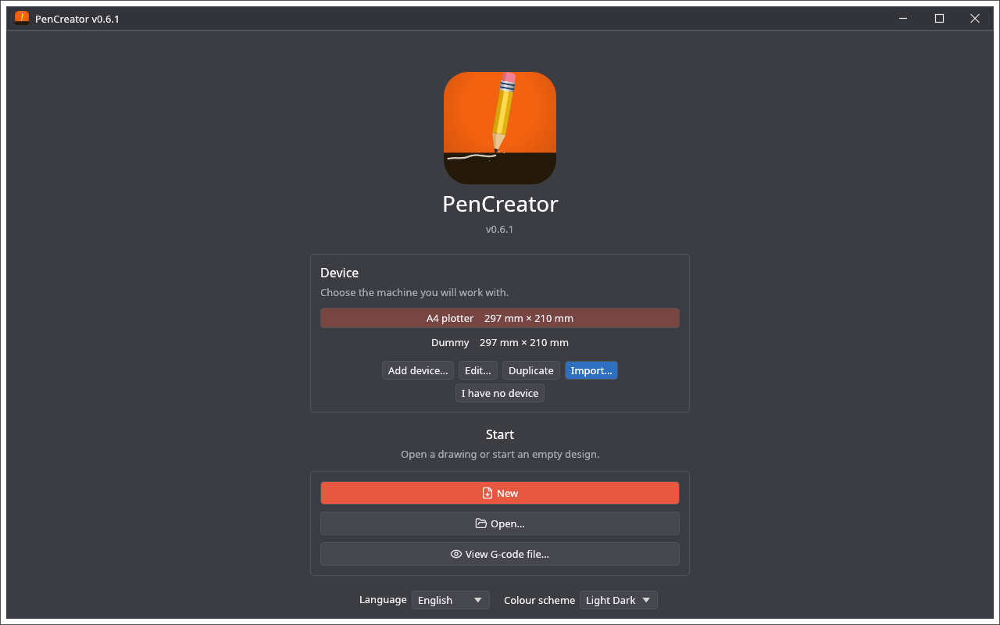
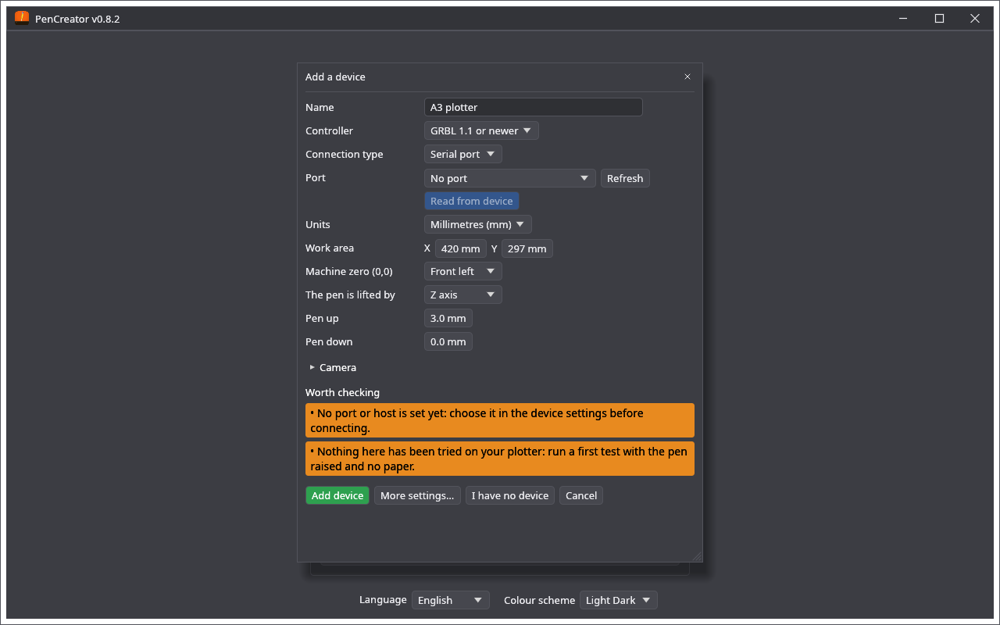
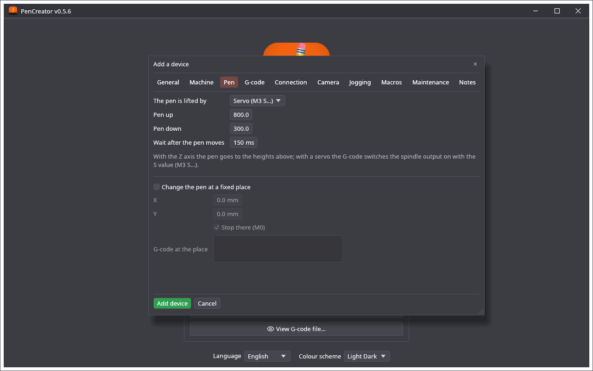
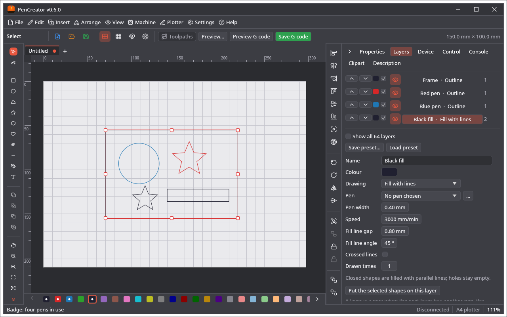
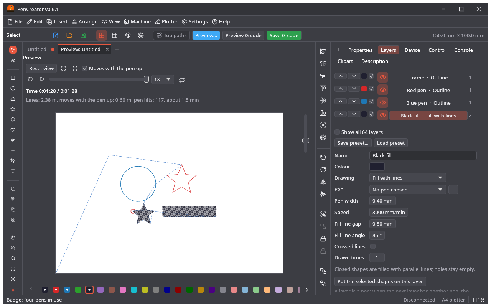

🌐 **English** · [Polski](Szybki-start)

# Quick Start

A first job from start to end: choose the plotter, draw or import something, give the shapes their pens, look at the plot and the G-code, and save the G-code (or send it to the machine).

> PenCreator has been tested on a pen plotter built after the [Drawing Robot](https://www.printables.com/model/137296-drawing-robot-arduino-uno-cnc-shield-grbl) (Arduino UNO, CNC Shield, GRBL); your machine may differ. The G-code is also checked by automatic tests and in a GRBL simulator. Read [Safety and Limitations](Safety-and-Limitations) before you run a job.

## 1. Choose the device

The start screen lists your plotters under **Device** (each with the size of its work area). Click one to choose it.

* **I have no device** adds and chooses a plain device called **Dummy**: an A4 sheet, the pen lifted by the Z axis. Under the list, **Paper** A4 **Landscape** / **Portrait** turns its sheet (later the same is on the **Device** tab of the editor). Without any device, **New** and **Open…** use the Dummy.
* **Add device…** opens one window with the basic settings, the same as in LightCreator and MillCreator: the **Name**, the **Controller** (a GRBL version, an AxiDraw / EggBot, an HPGL plotter or LinuxCNC), the connection with **Read from device** (a GRBL gives its work area and speed), the **Units**, the **Work area** (X and Y, the sheet the pen can reach), the **Machine zero (0,0)** (the corner where the pen starts), **The pen is lifted by** the **Z axis** (then **Pen up** and **Pen down** are heights in mm; down 0 is the paper) or a **Servo (M3 S…)** (then they are `S` values, 0 … 1000), an optional camera, and **Worth checking**. A new device starts with up 3 mm and down 0.

  **Add device** saves it; **More settings…** opens the whole device window with what is entered (the wait after the pen moves, the speed of the moves with the pen up, the **Acceleration of X, Y, Z** and the **Junction deviation** for the time of a drawing, **Start from → A usual sheet size…**). **Edit…**, **Duplicate** and **Import…** (a device file) are next to **Add device…**.

If the program was closed with work that was not saved, the start screen first says *A project that was not saved was found*: **Recover** opens it, **Discard it** forgets it.

## 2. Start a drawing

Under **Start**:

* **New** starts an empty drawing on the sheet of the device.
* **Open…** opens a project (`.cre`), an SVG, a PDF or an Illustrator (`.ai`) file; a DXF or a UGS design (`.ugsd`) is imported into a new drawing.
* **View G-code file…** shows the toolpaths of a G-code file, without a drawing.
* Under **Open recent** are the last five files.

The editor has the menu bar (see [Menus](Menus)), a bar of buttons under it, the tools on the left, the arrange bar and the side panel on the right (the tabs **Properties**, **Layers**, **Device**, **Control**, **Console**, **Clipart**, **Description**, and **Camera** when the device has a camera), the row of layers under the work area and the status line at the bottom (the message, the zoom and the pointer, the device of the project, the connection).

Each drawing is a tab above the work area; **New** (Ctrl+N) or the **+** at the end of the tabs opens another one (at most 10). A file dropped on the window is opened: a picture goes through the import dialog, a LightBurn, UGS or DXF file is imported into the drawing, a G-code file is shown in the analysis.

### The project setup

After **New** the window **Project setup** (also **File → Project setup…**) asks about the **Sheet**: its width and height, or a **Paper size** from a list of the usual ones (A6 … A1, B5, B4, Letter, Legal, Tabloid) with only those that fit the plotter, upright (↕) or lying (↔); or a **Cylinder (rotary)** (its diameter and length; applying switches the rotary attachment on). The green **Apply** and the blue **Skip** are at the bottom of the window; **Skip** (or closing the window) of a new project leaves it on one side over the whole work area of the plotter. The sheet lies in the corner of the zero of the plotter, 3 mm in from the edges (a dashed outline). A **Two-sided job** gives side A and side B with a **Side A / Side B** switch over the work area: choose the line the sheet is **Turned over round**, **H** (back and front change places) or **V** (left and right change places), and whether to add **Alignment marks** (four corner marks just outside the sheet, on layer 64, drawn on the paper under it before side A). Side B is drawn as the sheet lies after it is turned over and is plotted as drawn (the job is the side that is shown); each side shows the other turned over as faint dashed **ghosts**.

## 3. Draw or import

* **Draw** with the tools on the left: **Select (V)**, **Node edit (N)**, **Rectangle (R)**, **Ellipse (E)**, **Triangle (Y)**, **Star (S)**, **Polygon (G)**, **Heart (K)**, **Spiral (I)**, **Line (L)**, **Polyline / pen (P)**, **Text (T)**, **Pan (H)**, **Zoom in (Z)** and **Zoom out (X)**. The **Insert** menu has the same drawing tools. The **Properties** tab changes the size, the place and the details of the selected shape.
* **Import** with **File → Import**: **Import image…**, **Import SVG…**, **Import Adobe Illustrator / PDF / EPS / VectorCraft…**, **Import DXF…**, **Import LightBurn / MillMage project…**, **Import UGS design…**, or the importers and generators of plugins. The shapes are added to the drawing, selected. A UGS design also sets up the empty layers for its ways of cutting (a pocket or a fill becomes **Fill with lines**, the others **Outline**).
* **Clipart**: the **Clipart** tab has a gallery of pictures to place, and **Insert → Online clipart…** searches the internet.

Text is drawn as the outlines of the font (each letter round its edge), not with single lines. See [Design Tools](Design-Tools) for editing, arranging and pictures.

## 4. Give the shapes their pens

New shapes go on the **active layer**. A layer is a pen:

1. Select shapes and click a colour in the row of layers under the work area: they move to that layer, and it becomes the active one. (Or, on the **Layers** tab, choose the layer and press **Put the selected shapes on this layer**.)
2. On the **Layers** tab set the layer: **Drawing** (**Outline**, **Fill with lines**, **Fill and outline** or **Picture**), **Pen** (a pen of **Plotter → Pen library…**), **Pen width**, **Speed**, the fill lines and **Drawn times**.
3. The list of layers is the order of the job (▲ / ▼ move a layer). A layer that is not ticked is not drawn.

When the next layer needs another pen, the job stops for the change. Everything about layers, pens and pen changes is on [Layers and Pens](Layers-and-Pens).

## 5. Look at the plot

**Plotter → Plot of the job…** (Ctrl+Shift+P), or the **Preview…** button in the bar under the menu, opens the tab **Preview: name** next to the drawing:

* the sheet with the lines the pens will draw, in their ink and thickness, and the moves with the pen up as dashed blue lines (**Moves with the pen up** switches them off); **Paper colour** next to it gives the sheet the colour of your paper (white until you choose one; **Automatic** goes back to white);
* an animation (**Play** / **Pause**, **Back to the start**, **Repeat**, **Animation speed**) with a slider of the progress; a red circle is the pen;
* the time (**Time** so far / in all; with the accelerations of the device it counts the speeding up and slowing down, the slower corners and the stops where the pen goes up or down, as GRBL plans them), the length of the lines and of the moves with the pen up, the number of pen lifts and the minutes;
* warnings in orange: a picture that cannot be drawn, a drawing that lies partly outside the work area, a fill with too many lines;
* The zoom bar in the lower left corner of the picture: zoom in, zoom out, **Reset view** (the work area) and **Fit all objects** (all the lines); the wheel zooms, a drag moves, a double click goes back to the first view.

The preview follows the drawing as you change it. The **Toolpaths** button (green while it is on) draws the same paths over the work area instead: the lines in the colours of their layers and the moves with the pen up in light blue.

## 6. Look at the G-code

**Preview G-code** (next to **Save G-code** in the bar) makes the G-code of the project and shows it as text in the tab **Preview G-code: name.nc**; nothing is written to the disk. It is the same G-code that **Save G-code** writes (its first line is `(PenCreator: name)`). The words are coloured (G and M words, axes, speeds, comments) and the text can be edited.

* **Save G-code** in the tab writes the text, with your edits, to a file.
* **Make again** makes it from the project again; when you have edited it, the button asks **Lose the edits?** first and a second click makes it.
* **Analyse** shows the toolpaths of the text in the **G-code analysis** tab.
* *Changed by hand* and a dot on the tab mark edits; closing such a tab asks whether to save them.
* While it has no edits, the text is made again by itself a moment after the project is saved, the notes (**Description** tab) change, a setting of the device changes or a postprocessor is switched on or off. Edits by hand are never thrown away by this.

The tabs can be put side by side: **View → Split view: side by side**, or drag a tab to another pane (see [Panes and Tabs](Panes-and-Tabs)).

## 7. Save the project

**File → Save** (Ctrl+S) writes the project as `.cre` (the first time it asks for a name). From then on a change is also written to that file by itself, about 20 seconds later. The project holds the drawing, the layers, the notes of the **Description** tab and a note of the device; see [Project File](Project-File). The notes are also written at the top of the G-code as `(Note: …)` lines.

## 8. Save the G-code or plot it

**Save the G-code to a file:** the **Save G-code** button, or **Plotter → Export G-code…** (Ctrl+E). The file is named after the project (`name.nc`; `untitled.nc` before the project is saved). The status line says where it was saved and repeats the warnings. Postprocessors of plugins that are switched on change the file (see [Plugins](Plugins)). Send the file with your own program, or:

**Send it from PenCreator** to a GRBL plotter:

1. **Machine → Device settings…**, page **Connection**: the **Connection type** (**Serial port** or **Network (TCP, e.g. ser2net)**), the **Port** or the **Host**, and the **GRBL version** of the board. **Save**.
2. On the **Device** tab, **Connect**. The status line shows the state of the machine.
3. On the **Control** tab: **Raise the pen** and **Lower the pen** try the up and down positions; the jog buttons move the pen; **Frame** goes round the box of the drawing with the pen up.
4. **Start** sends the job. At a change of the pen the job stops and a window says which pen to put in: **Continue the job** goes on. **STOP** stops the job.

Machine control is described on [Machine Control](Machine-Control).
