🌐 [English](Screenshots) · [Polski](Zrzuty-ekranu) · [简体中文](Screenshots-ZH) · **한국어**

> ⚠️ 이 페이지는 영어판을 기계 번역한 것으로, 부정확한 부분이 있을 수 있습니다. 의심스러우면 [영어판](Screenshots)을 기준으로 하십시오. 수정 제안을 환영합니다.

# 스크린샷

모든 그림은 실제 인터페이스에서 헤드리스로 렌더링한 것입니다(`cargo test -p pencreator render_screenshots -- --ignored`).

### 시작 화면

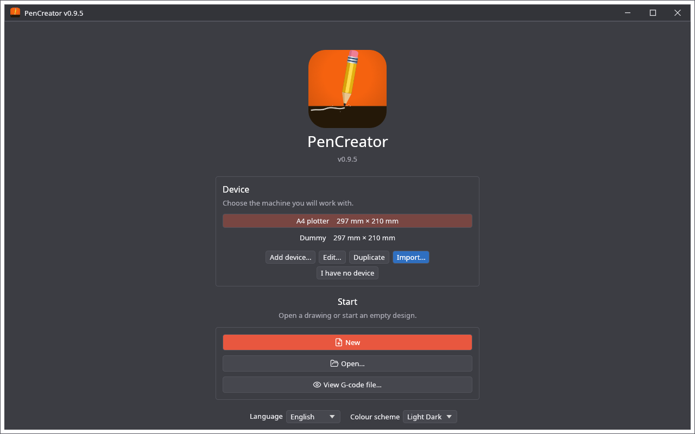

### 장치 추가

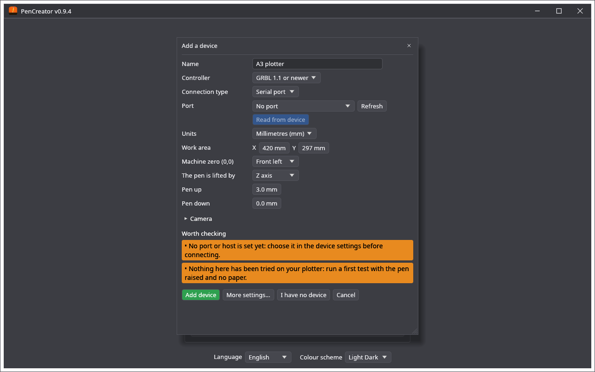

### 장치의 펜 페이지

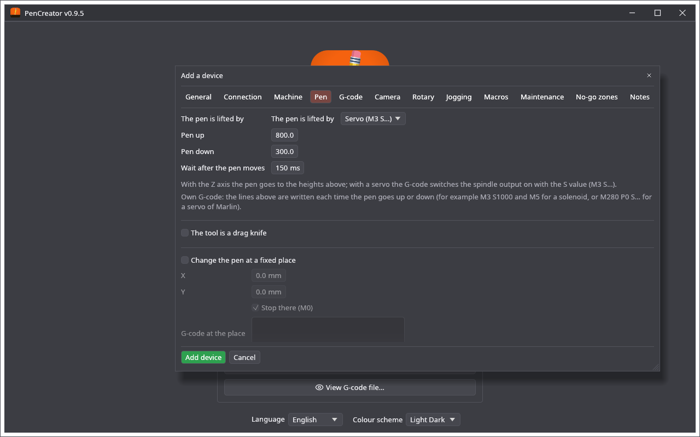

### 편집기의 배지, 속성 탭

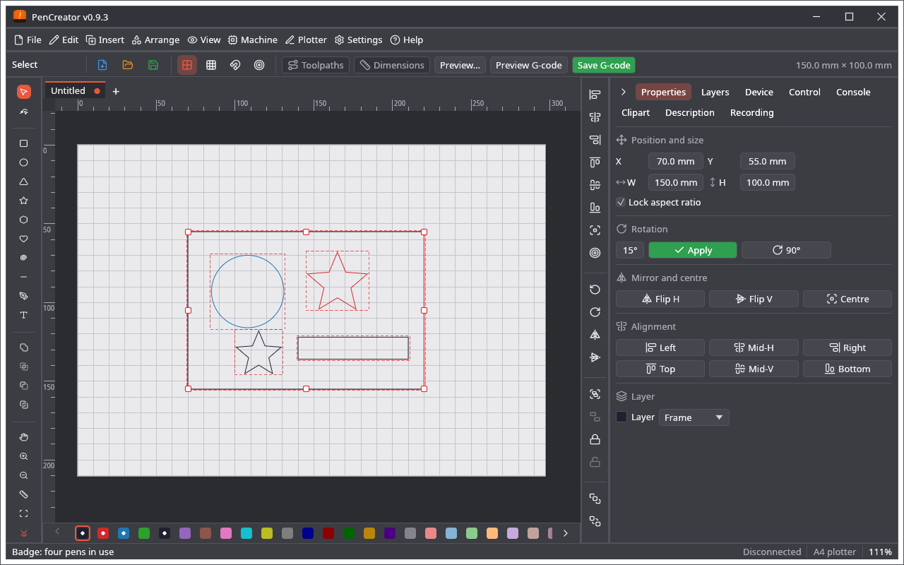

### 레이어 탭: 레이어는 곧 펜

### 장치 탭

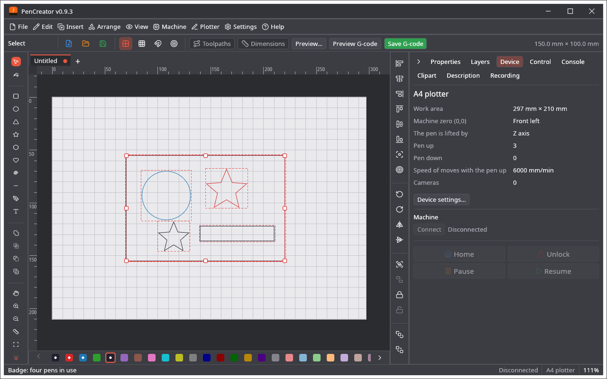

### 클립아트 갤러리

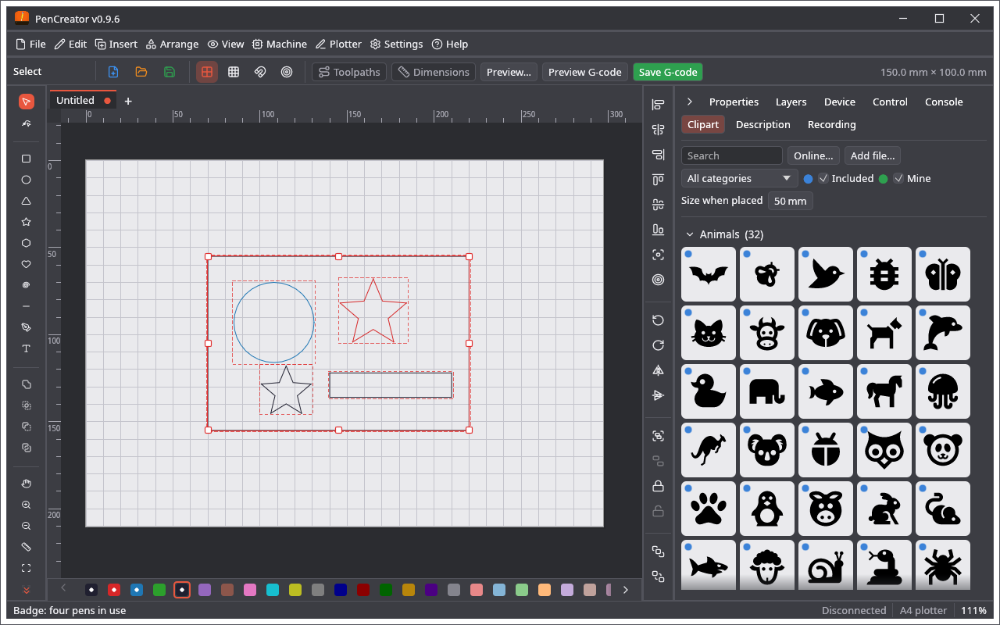

### 설명 탭

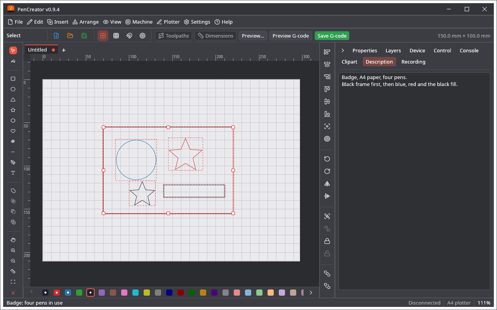

### 작업 플롯

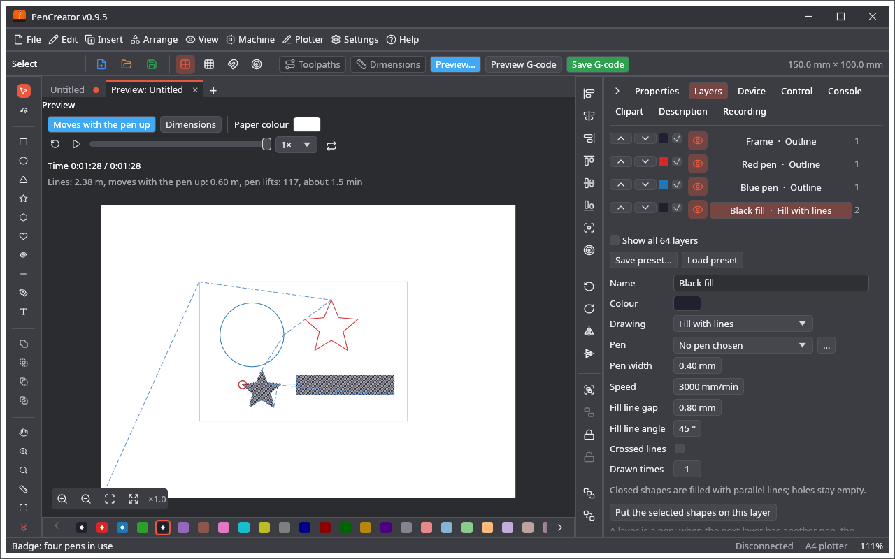

### 진행 중인 플롯

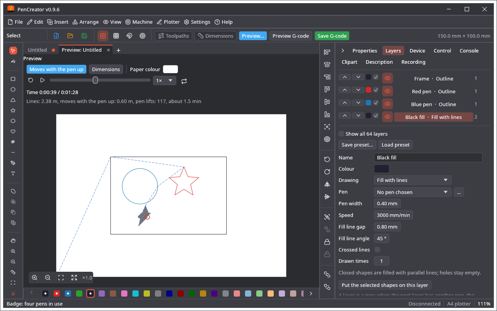

### 콘솔 탭: 컨트롤러와의 통신과 명령 입력 줄

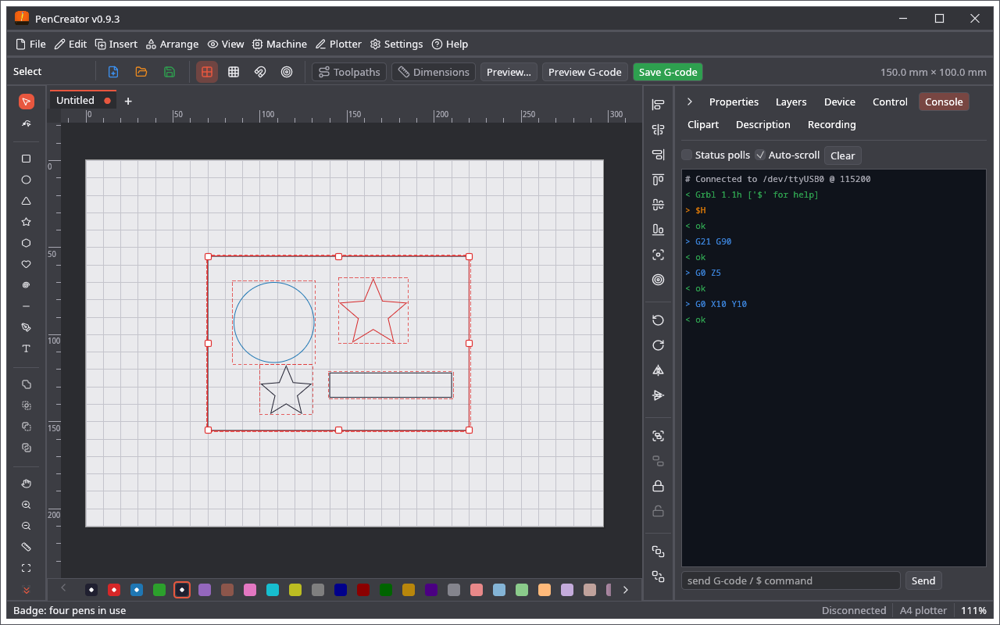

### 제어 탭: 위치, 원점, 조그, 매크로

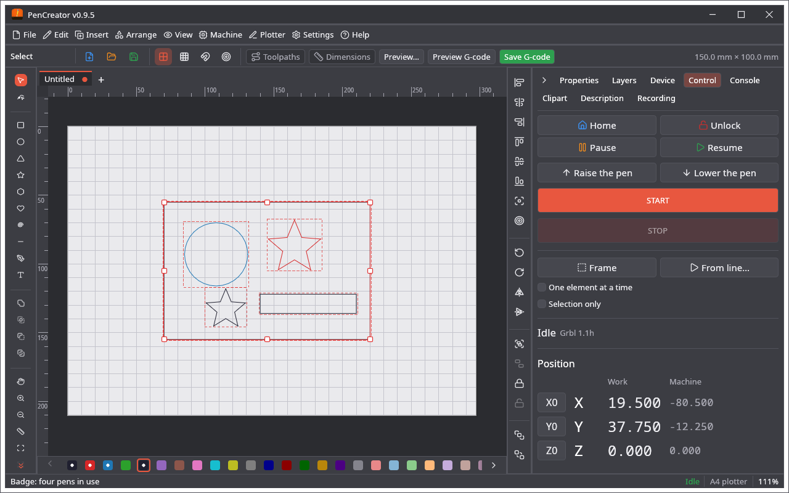

### 컨트롤러 설정 ($$)

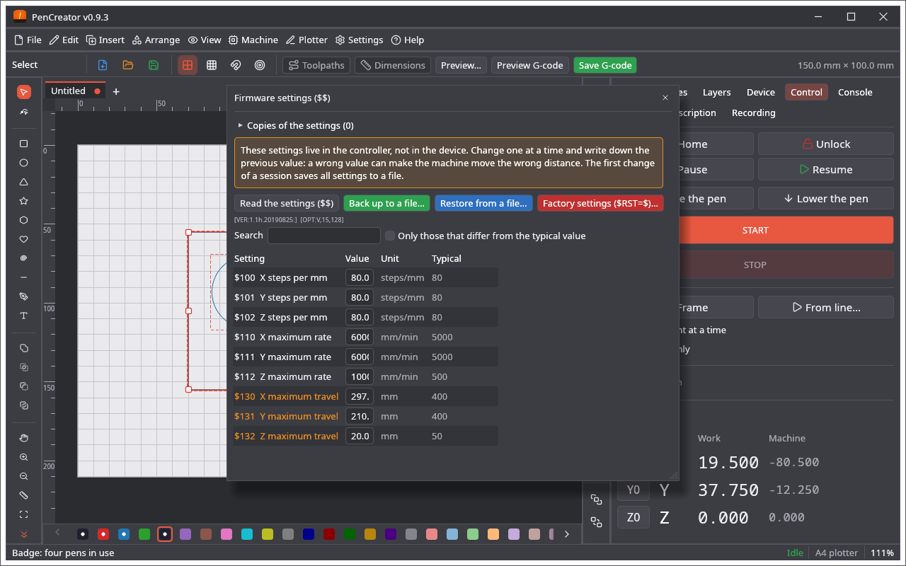

### 펜 교체를 기다리는 작업

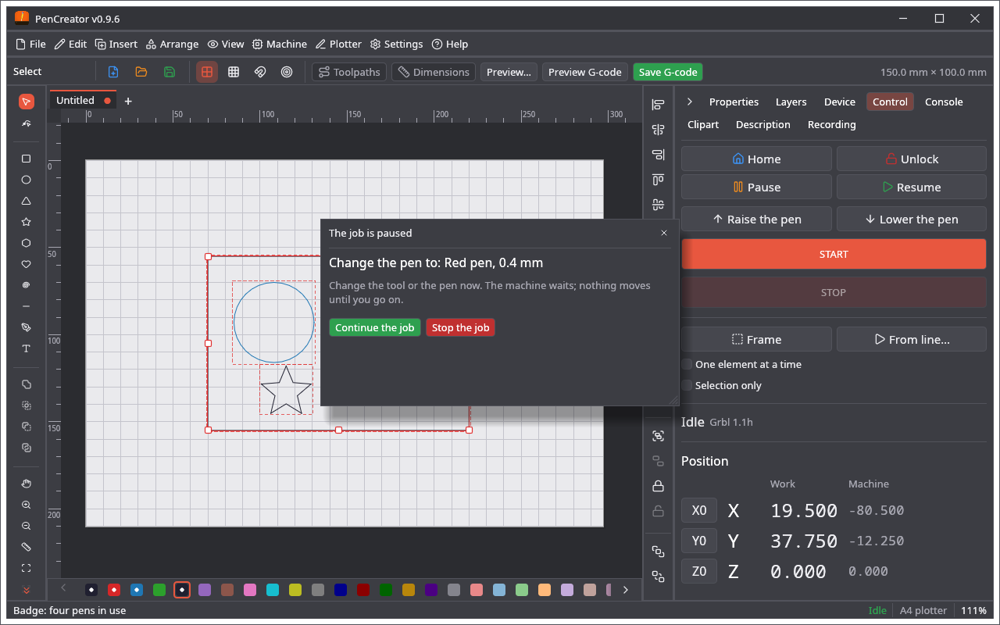
