🌐 [English](Screenshots) · [Polski](Zrzuty-ekranu) · **简体中文** · [한국어](Screenshots-KO)

> ⚠️ 本页由英文版机器翻译而成，可能有不准确之处。如有疑问，请以[英文版](Screenshots)为准。欢迎提出修改建议。

# 截图

所有图片都是从真实界面无头渲染生成的（`cargo test -p pencreator render_screenshots -- --ignored`）。

### 开始屏幕

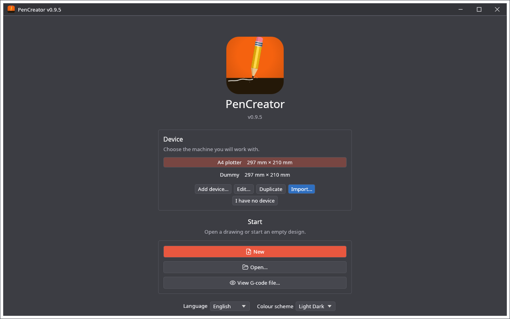

### 添加设备

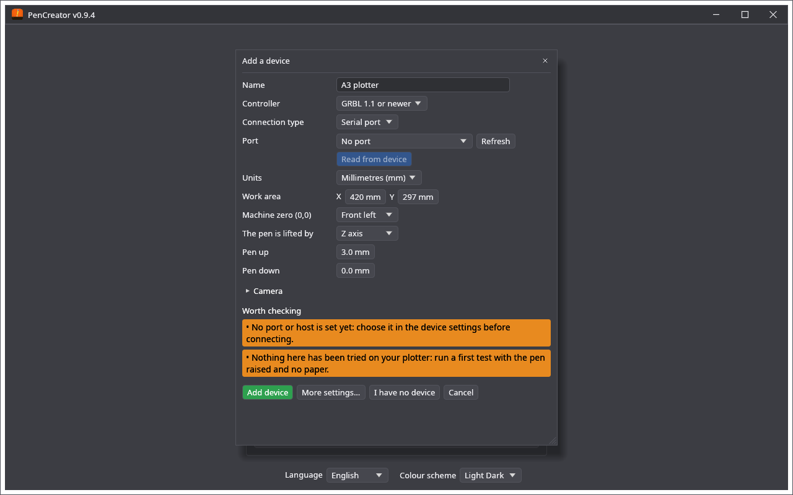

### 设备的笔页面

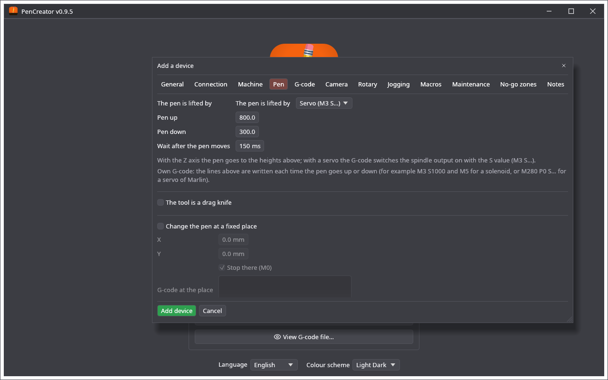

### 编辑器中的徽章，属性标签页

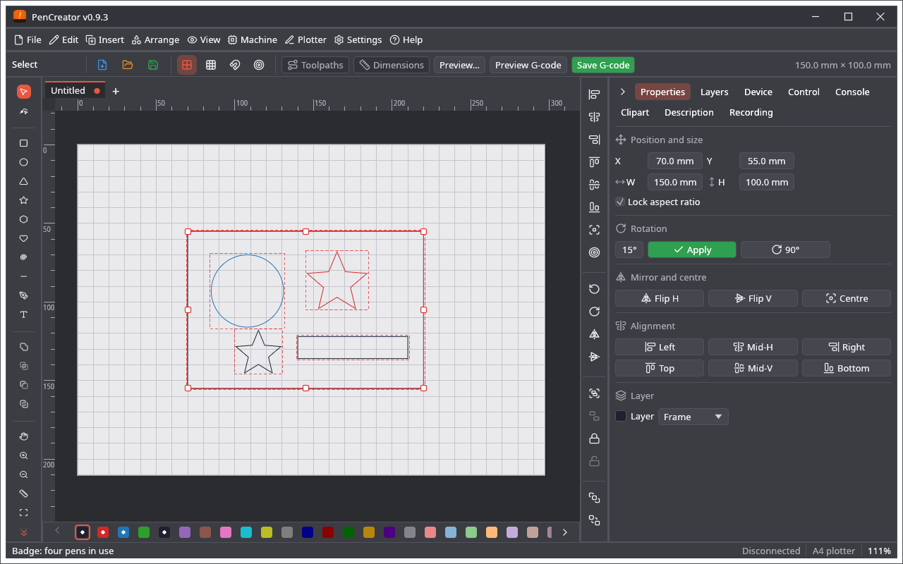

### 图层标签页：一个图层就是一支笔

### 设备标签页

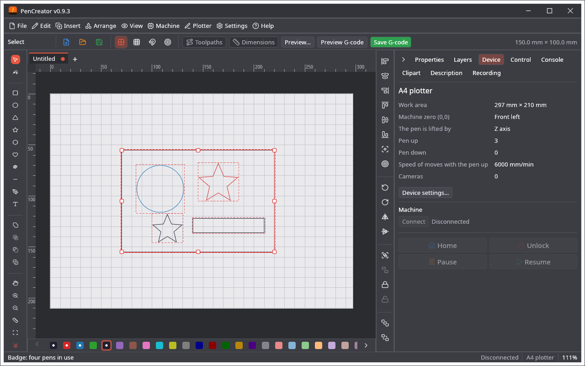

### 剪贴画库

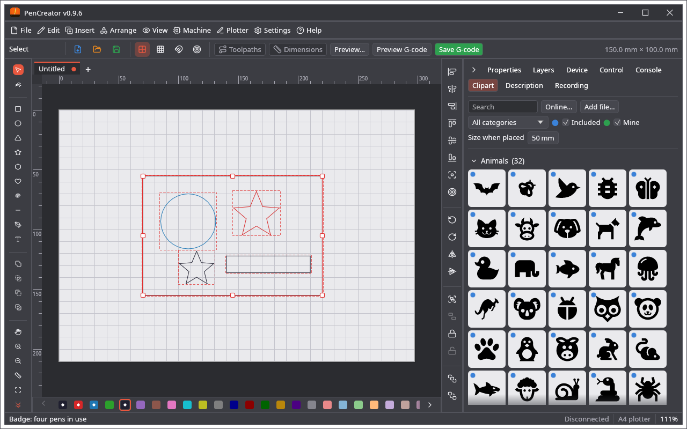

### 描述标签页

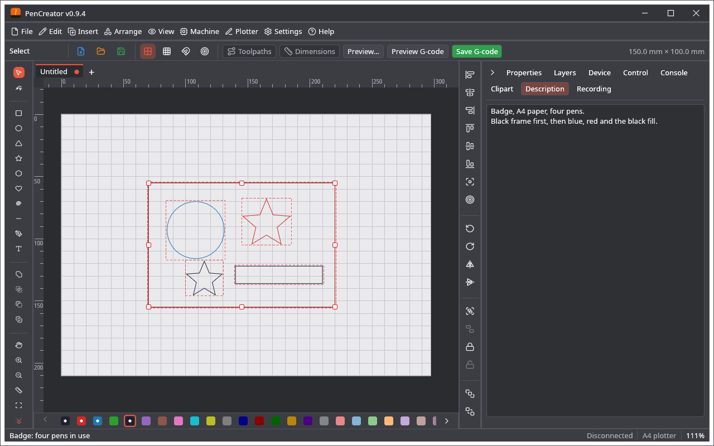

### 作业绘图

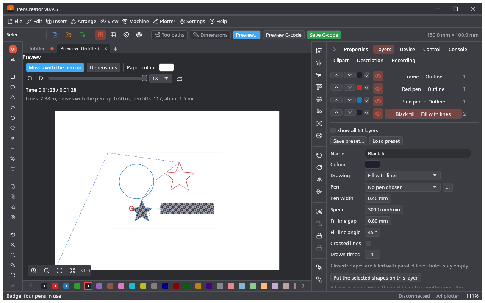

### 绘图进行到一半

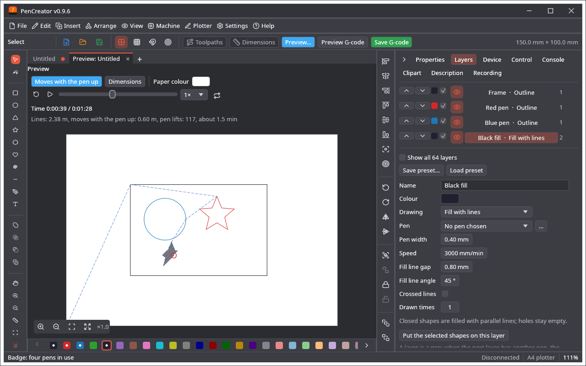

### 控制台标签页：与控制器的通信以及发送命令的输入行

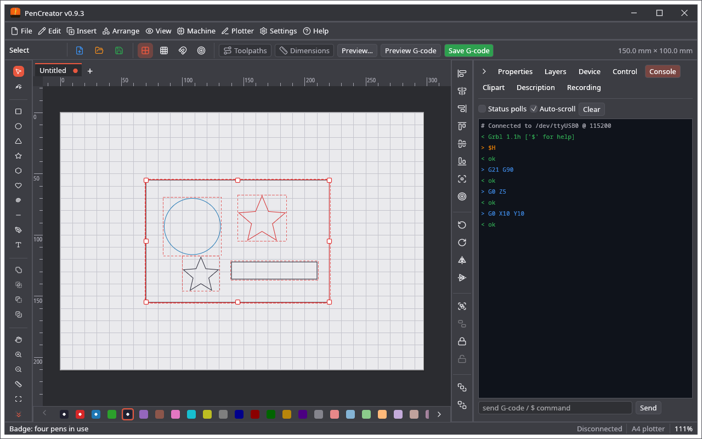

### 控制标签页：位置、归零、点动、宏

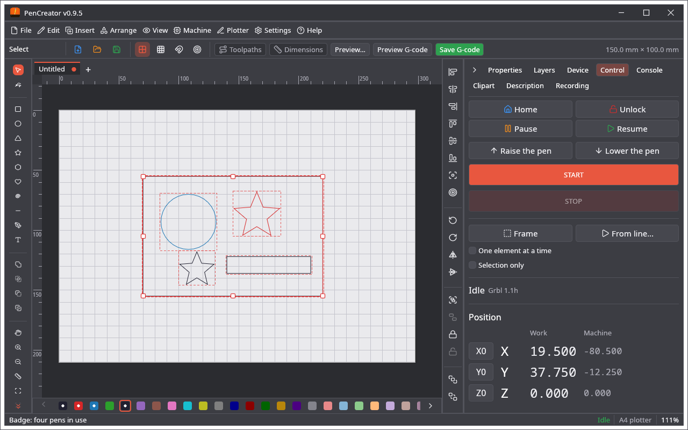

### 控制器设置（$$）

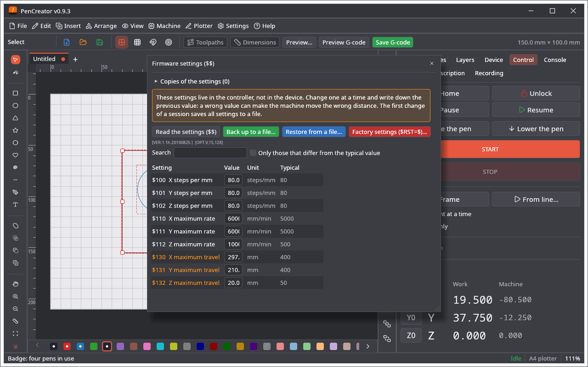

### 作业等待换笔

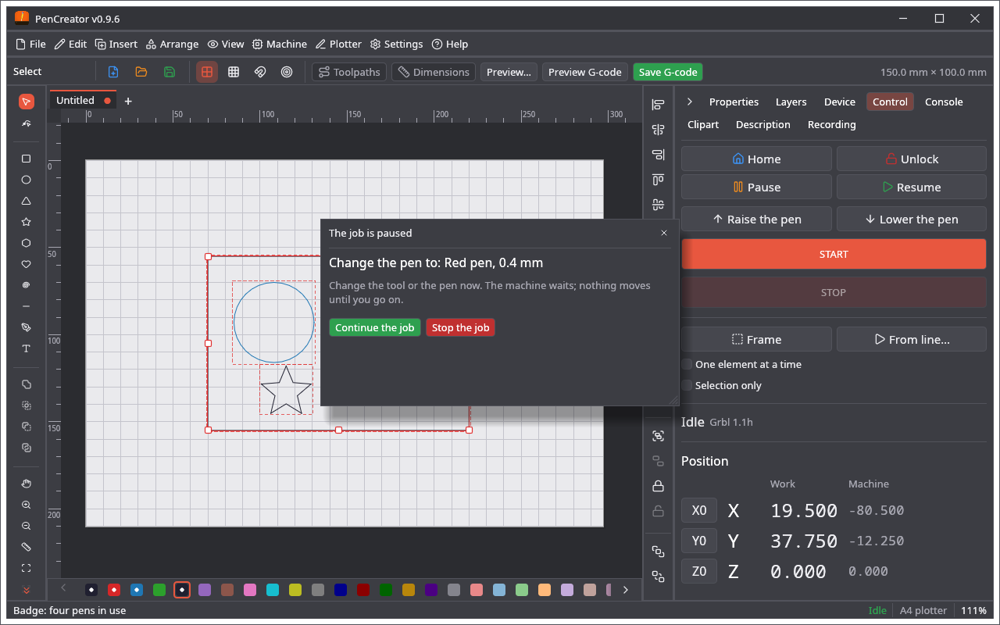
